## 1. Cover Page

YUVAINTERN  /  DATA ANALYTICS INTERNSHIP

Real-World Dataset
Analysis Project

Task 4 • Revised, evidence-based submission
UCI Online Retail

A complete transaction-data investigation: source validation, transparent cleaning, exploratory analysis, fully worked statistics and practical business recommendations.


**Table 1. Submission profile**

| Item | Detail |

| --- | --- |

| Prepared by | T. Aparna Reddy / Data Analytics Intern |

| Report date | 7 November 2026 |

| Dataset window | 1 December 2010, 08:26–9 December 2011, 12:50; timezone not supplied |

| Source size | 541,909 original invoice lines × 8 columns |

| Analysis views | 536,641 deduplicated records; 524,878 qualified sales lines; 19,960 sales invoices |

| Revision purpose | Resolve the five supplied reviewer criticisms with actual numerical evidence and reproducible calculations |

| Companion materials | Executed notebook, complete computational code, cleaned datasets, CSV evidence, validation and submission description |


15 analytical figures  •  14 fully worked examples  •  12 substantive findings  •  8 recommendations

Dataset attribution: Chen, D. (2015). Online Retail [Dataset]. UCI Machine Learning Repository. DOI: 10.24432/C5BW33. Dataset licensed CC BY 4.0; transformations are documented. No synthetic transaction records or claimed intervention outcomes are included. [1, 2]


<!-- page break -->

Contents

[TABLE_OF_CONTENTS]

The 19 numbered parts follow the requested order. This navigation page is front matter. The appendix contains the full computational source, not merely selected snippets. Original data and the completed Task 5 project have not been modified.


<!-- page break -->

## 2. Abstract / Executive Summary

This project investigates the genuine UCI Online Retail workbook to establish defensible measures of recorded sales, credits, customer value, product performance and geographic demand. All 541,909 source rows and eight fields were profiled. Removing 5,268 exact duplicate rows under an explicitly tested assumption produces 536,641 records. A separate positive-price, positive-quantity, non-credit view contains 524,878 lines, not a replacement for the complete cleaned dataset.

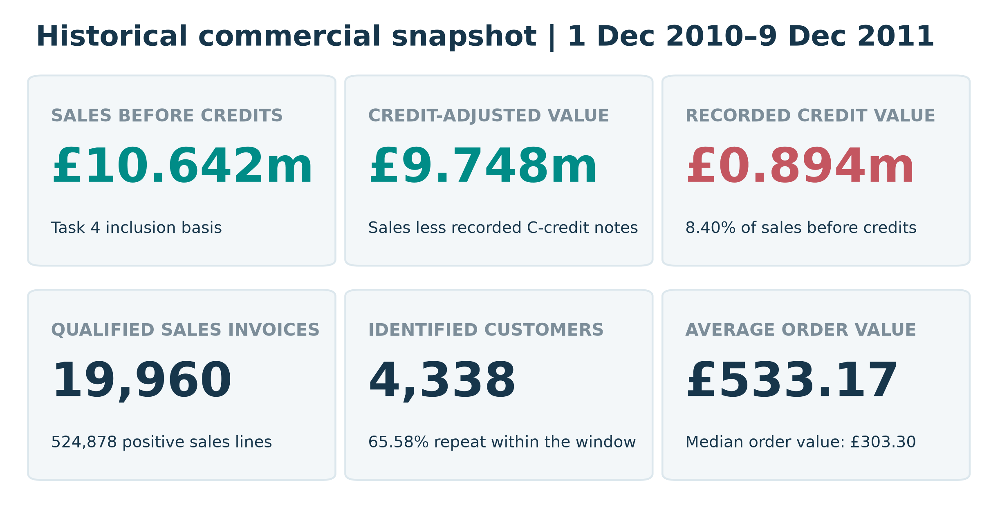

**Figure 1. Historical commercial KPI dashboard**

**Interpretation.** These KPIs use explicit transaction populations. Sales before credits are not accounting net revenue, and the 65.58% repeat share is a within-window description of identified purchasers rather than a cohort-retention estimate.

Source: outputs/metrics.json; unchanged UCI workbook [1].

**Principal results.** Sales before credits total **£10,642,110.80**; recorded C-credit notes of **£893,979.73** reduce this to **£9,748,131.07**. Mean invoice value is **£533.17**, compared with a **£303.30 median**. Two extreme sale–credit pairs fully offset **£245,653.20**, or **27.48% of credit value**. The UK generates **84.59% of sales**; Netherlands leads non-UK value but one account supplies **98.16%** of its identified sales.

**Interpretation and action.** The evidence supports credit-aware reporting, current-data validation of concentrated customer accounts, SKU planning based on credit-adjusted demand, and cautious geographic tests. It does not establish profit, causal drivers, campaign uplift or current performance. Fourteen worked examples expose the arithmetic; fifteen figures and their interpretations connect the calculations to decisions. The delivered scripts, notebook and data manifests make the findings auditable.


<!-- page break -->

## 3. Introduction

Transactional data are commercially useful only when the unit of analysis and inclusion rules are clear. A row in this workbook is an invoice line, not an independent order or customer. Positive sales, credits, zero-priced stock movements, service codes and accounting entries appear together. A generic total or an unexplained filter can therefore answer the wrong business question even when its arithmetic is correct.

The revised Task 4 applies Pandas and NumPy to the original workbook, then moves from row-level evidence to invoice, customer, product, country and month summaries. The objective is explanatory business analysis, not a predictive model. The report separates observed facts, analytical assumptions and proposed management actions. Associations are not interpreted as intervention effects.

The supplied reviewer feedback identifies five weaknesses: insufficient numerical examples, missing worked statistical calculations, limited original interpretation, incomplete sections and unsupported findings. The response below replaces generic statements with traceable records, formulas, comparisons, documented transformations and measurable recommendations. The previous Task 4 outputs are used only as a 24-metric cross-check; all revised results are independently executed from the verified workbook.

**Table 2. How this revision addresses the reviewer feedback**

| Reviewer criticism | Specific correction | Where to verify |

| --- | --- | --- |

| Too few concrete numbers | Raw/clean profiles, complete monthly totals, actual invoice rows and explicitly scoped KPI comparisons. | Sections 8–10; outputs/*.csv |

| Missing statistical workings | Fourteen examples with formula, actual substitution, calculation, interpretation and evidence file. | Section 11; worked_*.csv |

| Limited original interpretation | Credit-offset inspection, volume/AOV decomposition, denominator checks and market/account concentration. | Sections 10, 12 and 13 |

| Short or incomplete sections | All 19 requested parts; full column definitions, cleaning code, limitations and complete computational appendix. | Contents; Section 19 |

| Findings not supported by evidence | Twelve findings each link numbers, comparison, business meaning, importance and action to saved outputs. | Section 13; report_manifest.json |


### 3.1 Scope and decision boundary

The observation window is historical: 1 December 2010–9 December 2011. The last month is partial. This is one retailer’s recorded activity, not a random sample of the retail sector. Recommendations are proposals requiring fresh, permissioned operational data. No costs, profit margins, web-session conversion, campaign exposure, stock availability, credit reasons or post-project outcomes are supplied.


<!-- page break -->

## 4. Dataset Source and Description

### 4.1 Authenticity, reliability and provenance

UCI describes Online Retail as transactions of a UK-based, registered non-store retailer, mainly selling unique all-occasion gifts, with many wholesale customers. The repository provides a dataset DOI, documented variables, an official workbook and a CC BY 4.0 licence. These properties make it a traceable educational source; they do not make every field complete or every business interpretation authoritative. [1, 2]

The provided workbook is used unchanged. Its bytes match the previously independently downloaded official UCI archive. The script verifies the SHA-256 before analysis and stops on a mismatch. No alternative retail dataset, synthetic records or reconstructed customer identities are used.

**Table 3. Source verification**

| Property | Verified value |

| --- | --- |

| Official catalogue | https://archive.ics.uci.edu/dataset/352/online+retail |

| Dataset identifier | DOI 10.24432/C5BW33; Online Retail, not Online Retail II |

| Official archive | https://archive.ics.uci.edu/static/public/352/online+retail.zip |

| File and worksheet | Online Retail.xlsx / Online Retail |

| Workbook bytes | 23,715,344 |

| SHA-256 | 43465a06f2ccf7c8b5bd2892bc7defb52f97487934fe93b16ae4c3936424676d |

| Original dimensions | 541,909 rows × 8 columns |

| Observed timestamp range | 2010-12-01 08:26:00 to 2011-12-09 12:50:00 |

| Licence and changes | CC BY 4.0; deduplication, type/label normalization and derived analytical views documented in Section 9 |


**Source criticism.** UCI’s catalogue states “no missing values”, but the actual workbook contains 135,080 missing CustomerID values and 1,454 missing Description values. Measured workbook evidence takes precedence over that catalogue flag. The timestamp timezone, exact VAT treatment and operational reasons for credit notes are not supplied. Country means customer residence, not verified shipping destination. [1]

Evidence file: data/source_verification.json; outputs/raw_schema_profile.csv


<!-- page break -->

### 4.2 Complete data dictionary

**Table 4. All original columns, units and analytical roles**

| Column / imported dtype | Definition and units | Role and treatment |

| --- | --- | --- |

| InvoiceNo / object | Transaction document identifier; UCI states a C-prefix denotes cancellation. Numeric and alphanumeric values occur. | Nominal ID; convert to string. Group sale lines to invoices; preserve C-credit and A-prefixed financial documents. |

| StockCode / object | Item or service code. Alphanumeric labels such as POST and DOT coexist with merchandise codes. | Nominal ID; string, not arithmetic. Merchandise view excludes an explicitly listed non-product set. |

| Description / object | Product or entry text label, with missing values and edge whitespace. | Categorical text; fill missing labels with UNKNOWN and strip edges. Group products by StockCode, not unstable names. |

| Quantity / int64 | Signed units recorded on a line. Negative quantities may be credits or non-credit movements. | Numeric signed measure. Positive sales require Quantity > 0; negatives remain in complete cleaned data. |

| InvoiceDate / datetime64[ns] | Recorded date and time; timezone is unspecified. | Temporal explanatory dimension; earliest sale-line time assigns an invoice once to hour/day/month. |

| UnitPrice / float64 | Recorded unit amount in pounds sterling; includes zeros, sub-penny amounts and two negative adjustments. | Numeric currency measure; retain precision. Positive sales require UnitPrice > 0. Not an observed margin or cost. |

| CustomerID / float64 | Customer identifier; float import reflects missing values, not fractional IDs. | Nullable nominal ID; convert to Int64. No mean/SD of identifiers; no invented values for missing customers. |

| Country / object | Country label for customer residence according to UCI. | Categorical explanatory dimension. Original labels retained; not a causal treatment or shipping confirmation. |


### 4.3 Outcomes, explanatory variables and grains

There is no supplied target variable or supervised-learning task in this project. Derived descriptive outcomes are signed line value (Quantity × UnitPrice), sales invoice value (sum of qualified lines), order count, observed repeat share and credit-adjusted transaction value. Candidate explanatory dimensions are country, month, weekday, hour, basket line count, total quantity and recorded mean unit amount. Quantity and price mechanically construct value; their correlations cannot be treated as independent causal effects.

Five grains are kept distinct: source/cleaned line; qualified sales invoice; identified purchaser; merchandise StockCode; and country/month aggregate. A country’s unique-customer counts need not add to the overall unique count because eight purchasers occur under multiple country labels. Customer-level comparisons assign each ID to its earliest qualified invoice country, with invoice number breaking timestamp ties. This convention is documented rather than treated as corrected residence.


<!-- page break -->

## 5. Business Problem and Objectives

The central problem is to turn a mixed-quality transaction extract into trustworthy evidence for commercial prioritisation. Management needs to distinguish sales activity from retained transaction value, avoid gross-only rankings distorted by credits, recognise incomplete customer attribution and choose practical tests instead of claiming unsupported ROI. The following questions define the analytical scope.

**Table 5. Analytical questions, methods and business outputs**

| Question | Actual method | Decision supported |

| --- | --- | --- |

| Q1. How complete, unique and internally coherent is the workbook? | Per-column types, missing/unique counts, exact duplicates, sign checks and source-row inspection. | Set data-quality controls without discarding valid records. |

| Q2. What are sales before credits and credit-adjusted value? | Exclusive line partition; signed-value bridge; merchandise/service separation. | Finance definitions, exception queues and credit-aware dashboards. |

| Q3. What is a typical order, and how heavy is the upper tail? | Invoice mean/median/quartiles/SD, histogram, box plot and sensitivity. | Use typical and tail demand in planning rather than mean alone. |

| Q4. When does recorded demand peak? | Month, weekday and first-invoice-hour group-bys; November order/AOV decomposition. | Test current operational capacity around verified demand patterns. |

| Q5. How concentrated is identifiable customer value? | Frequency bands, repeat share, RFM and customer Pareto with explicit denominators. | Prioritise validated accounts and design retention/win-back tests. |

| Q6. Which merchandise products remain important after credits? | SKU gross/credit-adjusted comparisons, units and exact offset-pair inspection. | Avoid treating fully reversed bulk entries as credit-adjusted transaction value. |

| Q7. Which countries show value and breadth rather than one-account dependence? | Sales, invoices, AOV, customer counts and largest-account share. | Separate account management from broad-market expansion. |

| Q8. Which group differences and associations survive careful interpretation? | Spearman/Pearson, customer-level Welch and rank tests, 2×2 repeat comparison. | Form testable hypotheses, not causal or population-wide claims. |


### 5.1 Success criteria

A successful submission must reconcile the same workbook, expose every cleaning decision, provide at least five worked examples, use both plotting libraries and all required chart types, and connect findings to measurable actions. This version deliberately exceeds those evidence minima: fourteen worked examples, fifteen figures, twelve substantive insights and eight recommendations. Readiness is checked against the ten requested review criteria; a 90+/100 official grade is an objective, not a guaranteed result.


<!-- page break -->

## 6. Tools and Technologies

**Table 6. Executed analysis environment**

| Tool / actual version | Use in this project |

| --- | --- |

| Python 3.13.16 | File handling, pipeline execution, hashing, comments and reproducible scripts. |

| Pandas 2.2.3 | Excel import, missing/duplicate profiling, nullable types, group-bys, joins and CSV exports. |

| NumPy 2.3.5 | Actual-array arithmetic, squared deviations, manual Pearson/Welch workings and conditional flags. |

| SciPy 1.17.1 | Welch t-tests, Mann–Whitney comparisons, chi-square and conditional t intervals. |

| Matplotlib 3.11.2 | Bar, histogram, line, scatter, multi-panel and reconciliation figures. |

| Seaborn 0.13.2 | Box plot, annotated correlation heatmap and customer-frequency count plot. |

| Jupyter / nbclient | Executed notebook with saved outputs and plots; cell failures are not allowed. |

| python-docx / LibreOffice Writer | OOXML Word generation, real contents/page-field refresh and PDF layout verification. |

| Git / GitHub; Google Drive / Docs | Versioned project packaging and submission publication where authorised; verified status is recorded separately. |


requirements.txt records the exact installed analysis versions, rather than merely listing package names. Source precision is preserved during computation; presentation amounts are usually rounded to pennies. Negative/positive penny-rounded account checks explicitly avoid floating-point near-zero classification errors. References [3–5] document the principal APIs; the SciPy web manual is newer than the installed version, so the actual runtime above is authoritative.

## 7. Methodology

The workflow is a reproducible, descriptive pipeline: verify source → profile raw data → preserve an immutable original → document deduplication and non-destructive normalization → create separately named analytical views → aggregate at an appropriate grain → run EDA and statistical checks → visualise → interpret → recommend → validate and package.

- **Verification before analysis:** compare workbook bytes/SHA-256; assert 541,909 × 8 and valid source timestamps; retain the original Excel file.

- **Scope before aggregation:** use mutually exclusive line partitions and explicitly label before-credit, credit-adjusted and all-line signed values. Keep anonymous sales in overall totals.

- **Evidence before narrative:** export raw/valid descriptive statistics, record-level worked tables, full month/country/SKU/customer summaries and source-row-traceable cleaned records.

- **Appropriate comparisons:** prefer customer-level AOV to treating repeated customer invoices as independent; show effect sizes and skew/rank sensitivity; describe p-values as conditional exploratory evidence.

- **Quality before handoff:** reconcile 24 previous metrics, cross-check arithmetic independently, execute the notebook, verify figure types and report order, render the Word document and inspect publication accessibility.

Evidence file: scripts/verified_core.py; scripts/analyze.py; scripts/make_charts.py; tests/validate_outputs.py


<!-- page break -->

## 8. Dataset Exploration

### 8.1 Shape, schema, missingness and uniqueness

The raw dataset contains 541,909 rows and eight original columns, with 25,900 distinct document identifiers, 4,070 StockCodes, 4,372 non-missing CustomerIDs and 38 country labels. InvoiceNo is not unique per row because documents have multiple product lines. Description has 4,223 non-missing distinct labels, more than the number of StockCodes; names are therefore not used as the primary product key.

**Table 7. Complete raw schema and null/unique profile**

| Column | Raw dtype | Missing n | Missing % | Unique non-null |

| --- | --- | --- | --- | --- |

| InvoiceNo | object | 0 | 0.0000% | 25,900 |

| StockCode | object | 0 | 0.0000% | 4,070 |

| Description | object | 1,454 | 0.2683% | 4,223 |

| Quantity | int64 | 0 | 0.0000% | 722 |

| InvoiceDate | datetime64[ns] | 0 | 0.0000% | 23,260 |

| UnitPrice | float64 | 0 | 0.0000% | 1,630 |

| CustomerID | float64 | 135,080 | 24.9267% | 4,372 |

| Country | object | 0 | 0.0000% | 38 |


CustomerID is missing on 135,080 raw lines (24.9267%), compared with only 1,454 missing Description values (0.2683%). No missing values occur in the other six fields. Missingness does not justify deleting all affected rows: anonymous activity still has measurable sales value, and an unknown product label does not invalidate a recorded amount.

Exact duplicate rows number 5,268, representing 0.972119% of the source. The duplicate test uses all eight original columns, not InvoiceNo alone. A repeated invoice line might still represent legitimate repeated entry, so the original file is preserved and a no-dedup sales sensitivity is reported. There are zero zero-quantity rows; 10,624 raw rows have negative quantity and 2,517 have non-positive unit amounts. These sign flags overlap and cannot be added as mutually exclusive error counts.

Evidence file: outputs/raw_schema_profile.csv; outputs/missing_values.csv; outputs/extended_results.json


<!-- page break -->

### 8.2 Actual records and category distributions

**Table 8. Five actual source records (Excel rows 2–6)**

| Invoice | StockCode | Quantity | UnitPrice £ | Customer | Country |

| --- | --- | --- | --- | --- | --- |

| 536365 | 85123A | 6 | 2.55 | 17850 | United Kingdom |

| 536365 | 71053 | 6 | 3.39 | 17850 | United Kingdom |

| 536365 | 84406B | 8 | 2.75 | 17850 | United Kingdom |

| 536365 | 84029G | 6 | 3.39 | 17850 | United Kingdom |

| 536365 | 84029E | 6 | 3.39 | 17850 | United Kingdom |


All five lines belong to invoice 536365 and customer 17850 in the United Kingdom. The complete seven-line invoice, not just these five lines, is reconstructed in worked example 2. Thus the illustration remains connected to the actual data rather than a fabricated demonstration.

**Table 9. Most frequent raw country labels**

| Country | Raw lines | Share of all raw lines |

| --- | --- | --- |

| United Kingdom | 495,478 | 91.4320% |

| Germany | 9,495 | 1.7521% |

| France | 8,557 | 1.5790% |

| EIRE | 8,196 | 1.5124% |

| Spain | 2,533 | 0.4674% |

| Netherlands | 2,371 | 0.4375% |


The UK accounts for 495,478 raw lines (91.4320%), whereas its qualified sales-value share is 84.5861%. These percentages answer different questions: one counts all original lines, while the other weights only qualified sales by value. The difference is not evidence of an error or a causal country effect.

**Table 10. Frequent raw product/service codes and labels**

| Category | Raw line frequency | Context |

| --- | --- | --- |

| 85123A | 2,313 | Most frequent raw StockCode; 85123A |

| 22423 | 2,203 | 22423: REGENCY CAKESTAND 3 TIER |

| WHITE HANGING HEART T-LIGHT HOLDER | 2,369 | Most frequent raw Description label; not identical to code frequency |

| Missing Description | 1,454 | Missing labels are not a recovered product category |


Complete distributions of Country, StockCode and Description are delivered as CSVs, not truncated to the categories shown here. Customer-frequency bands and segment distributions are analysed after defining a valid sale and a known purchaser in Sections 9–10.

Evidence file: outputs/actual_first_ten_rows.csv; outputs/raw_country_frequencies.csv; outputs/raw_stockcode_frequencies.csv; outputs/raw_description_frequencies.csv


<!-- page break -->

### 8.3 Complete numeric descriptions: original records

Summary statistics are calculated only for genuine measures. InvoiceNo, StockCode and CustomerID are nominal identifiers even when they look numeric; their averages are not business statistics. Sample standard deviation uses ddof = 1. Quantiles use Pandas’ default linear interpolation. Mode is the first sorted mode; each displayed measure has one mode in this dataset. [3]

**Table 11. Raw numerical summary; signed values retained**

| Statistic | Quantity (units) | UnitPrice (£) | Derived signed line value (£) |

| --- | --- | --- | --- |

| Count | 541,909 | 541,909 | 541,909 |

| Mean | 9.552250 | 4.611114 | 17.987795 |

| Median | 3.000 | 2.080 | 9.750 |

| Mode | 1.000 | 1.250 | 15.000 |

| Sample SD | 218.081158 | 96.759853 | 378.810824 |

| Minimum | -80,995.000 | -11,062.060 | -168,469.600 |

| 25th percentile (Q1) | 1.000 | 1.250 | 3.400 |

| 75th percentile (Q3) | 10.000 | 4.130 | 17.400 |

| Maximum | 80,995.000 | 38,970.000 | 168,469.600 |

| Interquartile range | 9.000 | 2.880 | 14.000 |


Raw mean quantity is 9.552250 units, yet the median is 3 and the range is −80,995 to +80,995. Raw UnitPrice includes −£11,062.06 accounting adjustments and a £38,970 entry; those values are inspected by transaction type rather than labelled ordinary merchandise prices. The negative and positive signed-value tails can partially offset: a simple raw mean conceals distinct commercial processes.

Evidence file: outputs/raw_descriptive_statistics.csv; outputs/negative_price_exceptions.csv

### 8.4 Qualified sales and invoice-level summaries

**Table 12. Valid-view summary at explicitly different grains**

| Statistic | Line Qty | Line UnitPrice £ | Line value £ | Invoice value £ |

| --- | --- | --- | --- | --- |

| Count | 524,878 | 524,878 | 524,878 | 19,960 |

| Mean | 10.616600 | 3.922573 | 20.275399 | 533.171884 |

| Median | 4.000 | 2.080 | 9.920 | 303.300 |

| Mode | 1.000 | 1.250 | 15.000 | 15.000 |

| Sample SD | 156.280031 | 36.093028 | 271.693566 | 1,780.412288 |

| Minimum | 1.000 | 0.001 | 0.001 | 0.380 |

| 25th percentile (Q1) | 1.000 | 1.250 | 3.900 | 151.695 |

| 75th percentile (Q3) | 11.000 | 4.130 | 17.700 | 493.462 |

| Maximum | 80,995.000 | 13,541.330 | 168,469.600 | 168,469.600 |

| Interquartile range | 10.000 | 2.880 | 13.800 | 341.767 |


This table may continue onto the next page; its header repeats. Source values such as a £0.001 unit amount are preserved, not silently rounded to zero for filtering.

The qualified invoice mean of £533.171884 exceeds its £303.30 median by about 75.79%. Its sample SD is £1,780.412288 and skewness is 51.078, so a symmetric “average customer” story would be misleading. Positive line quantity has median 4 and Q3 11; a very large wholesale or fully credited entry can coexist with mostly small line quantities.

Evidence file: outputs/valid_descriptive_statistics.csv; outputs/metrics.json


<!-- page break -->

### 8.5 Unusual observations requiring inspection

**Table 13. Anomaly register: evidence and treatment**

| Observation | Actual evidence | Interpretation / treatment |

| --- | --- | --- |

| Extreme merchandise line | Invoice 581483, StockCode 23843: 80,995 × £2.08 = £168,469.60. | Matching C581484 offsets it in full; retain both records and report adjusted value. |

| Second extreme pair | 541431 / C541433, StockCode 23166: ±74,215 × £1.04 = ±£77,183.60. | No retained pair value; do not infer fraud, fulfilment failure or a return reason. |

| Negative unit amounts | A563186 and A563187 each show Quantity 1, UnitPrice −£11,062.06, Description “Adjust bad debt”. | Separate financial adjustments, not assumed erroneous merchandise. |

| Missing product label | Excel row 624, invoice 536414, code 22139 has no source Description. | Use UNKNOWN without inventing a recovered product name. |

| Timestamp inconsistency | 42 qualified invoices have more than one line timestamp; maximum span 60 seconds. | Assign each invoice to its earliest timestamp so hourly counts are additive. |

| Customer/country variation | Eight identified purchasers have qualified sales under multiple country labels. | Retain source labels; declare first-observed assignment only for customer-level comparisons. |


These observations distinguish data-quality issues from valid but unusual transactions. A statistical outlier flag is not proof of an error. The source is a retail/wholesale mix, and neither the business process nor a reason code is available to justify deleting a large sale. The cleaning stage therefore preserves a complete, traceable record set and builds separate views for each question.

Evidence file: outputs/extreme_transaction_pairs.csv; outputs/negative_price_exceptions.csv; outputs/invoice_timestamp_exceptions.csv; outputs/extended_results.json


<!-- page break -->

## 9. Data Cleaning and Preprocessing

Every transformation below identifies the issue, literal Python operation, before/after state, reason and effect. Row removal is distinguished from formatting, validation, flagging and analytical-view selection. SourceRow is the original Excel row number including the header offset. The full implementation appears in Section 19 and scripts/analyze.py.

### 9.1 Exact duplicates: remove under an explicit assumption

**Issue and before/after:** 541,909 source rows contain 5,268 exact duplicates across all eight original columns. Keeping the first occurrence gives 536,641 rows, with zero remaining exact duplicates before formatting. Excel rows 496 and 519 both contain invoice 536409, StockCode 21866, quantity 1, £1.25, customer 17908, timestamp 1 December 2010 11:45 and the same label/country.

```python
clean = raw.drop_duplicates().copy()
clean.insert(0, 'SourceRow', clean.index + 2)
```

**Reason and effect:** identical entries are treated as duplicate capture, not independently verified duplicate business events. The original file is untouched. Sales before deduplication are £10,666,684.54, compared with £10,642,110.80 afterwards: a £24,573.74 difference, or 0.2304% of the no-dedup amount. This sensitivity exposes the assumption rather than hiding it.

### 9.2 Identifier and CustomerID types: lossless correction

**Issue and before/after:** InvoiceNo/StockCode are mixed object columns; CustomerID imports as float64 with 135,037 missing values after deduplication. IDs such as 17850.0 are labels, not continuous measurements. All present CustomerIDs have zero fractional part.

```python
for col in ['InvoiceNo', 'StockCode']:
    clean[col] = clean[col].astype('string').str.strip()
assert ((clean.CustomerID.dropna() % 1) == 0).all()
clean['CustomerID'] = clean.CustomerID.astype('Int64')
```

**Reason and effect:** nominal IDs remain intact, C/A prefixes survive and customer 17850.0 becomes 17850. The missing count stays 135,037; rows stay 536,641. No customer ID is inferred or imputed, and leading-zero semantics are not invented beyond the source representation.

### 9.3 Date validation: verify, do not invent a repair

**Issue and before/after:** InvoiceDate is already datetime64[ns], with zero missing timestamps on 541,909 raw rows and 536,641 deduplicated rows. There is no parse-failure count to “fix”.

```python
clean['InvoiceDate'] = pd.to_datetime(clean.InvoiceDate, errors='coerce')
assert clean.InvoiceDate.notna().all()
```

**Reason and effect:** validation prevents an unreported parse failure; it changes neither rows nor dates. No timezone is supplied, so no timezone conversion or opening-hours inference is made.

Evidence file: outputs/cleaning_step_audit.csv; outputs/duplicate_examples_with_source_rows.csv; outputs/extended_results.json


<!-- page break -->

### 9.4 Description missingness and edge whitespace

**Issue and before/after:** 1,454 descriptions are missing after deduplication. Filling only those labels produces zero null Description values; these are still unknown product names, not recovered information. Excel row 624 becomes UNKNOWN. Separately, 112,371 non-null/sentinel descriptions have removable edge whitespace; the value at row 12 changes from "POPPY'S PLAYHOUSE BEDROOM " to "POPPY'S PLAYHOUSE BEDROOM". No empty strings remain after stripping.

```python
clean['Description'] = clean.Description.astype('string').fillna('UNKNOWN')
clean['Description'] = clean.Description.str.strip()
clean.loc[clean.Description.eq(''), 'Description'] = 'UNKNOWN'
```

**Reason and effect:** retain valid quantities/amounts when the label is absent, and normalize formatting without claiming a canonical catalogue mapping. All 536,641 rows remain and signed financial value is unchanged. Product grouping uses StockCode, so label variations are not silently merged into product identities.

**Additional type issue:** one non-missing Description is the integer 20713 at Excel row 420393 (invoice 572891, code 23343). astype("string") preserves it as the text label "20713"; it does not guess a product name. Non-text descriptions change from one to zero, with no row or value change. This zero-priced, −400-unit movement remains in cleaned-all and is not a qualified sale. Calling .str.strip() directly on the mixed object column would instead create an unintended missing value for this cell.

### 9.5 Country formatting: a measured zero-change operation

**Issue and before/after:** the same edge-whitespace check is applied to country labels and finds zero affected rows. All 38 original raw labels remain; country residence is not relabelled as shipping country.

```python
clean['Country'] = clean.Country.astype('string').str.strip()
```

**Reason and effect:** consistent categorical strings with zero value, label or row changes. EIRE and other original categories are not arbitrarily renamed, merged or assigned a missing-country surrogate.

### 9.6 Credits and derived measures: preserve all transaction classes

**Issue and before/after:** sales, credits and financial movements coexist in 536,641 rows. Derive flags and signed line value without dropping any records. C-prefix matching uses uppercase for the check only; StockCode values remain as supplied.

```python
clean['IsCredit'] = clean.InvoiceNo.str.upper().str.startswith('C')
clean['IsOtherNegativeMovement'] = (~clean.IsCredit) & clean.Quantity.lt(0)
clean['HasCustomerID'] = clean.CustomerID.notna()
clean['LineValue'] = clean.Quantity * clean.UnitPrice
clean['Month'] = clean.InvoiceDate.dt.to_period('M').astype(str)
```

**Reason and effect:** 9,251 C-credit lines and 1,336 other negative-quantity lines stay in the complete dataset. Non-credit negative movements have aggregate signed value £0.00 in this file; that does not make their quantities meaningless. Multiplication preserves source sub-penny precision and presentation totals are rounded only afterwards.

Evidence file: outputs/cleaning_step_audit.csv; outputs/description_format_examples.csv; outputs/exclusive_line_partitions.csv


<!-- page break -->

### 9.7 Qualified sales: a separate view, not a deletion rule

```python
clean['IsQualifiedSale'] = ((~clean.IsCredit) & clean.Quantity.gt(0)
                            & clean.UnitPrice.gt(0))
sales = clean.loc[clean.IsQualifiedSale].copy()
```

**Before/after and reason:** the complete cleaned dataset stays at 536,641 rows; the separate sales view has 524,878. The other 11,763 rows are not labelled data errors. This view answers positive sales-activity questions; credit-adjusted reporting explicitly brings credits back into the calculation.

**Table 14. Mutually exclusive cleaned line partition**

| Partition | Lines | Signed value (£) |

| --- | --- | --- |

| Positive-price non-credit sales | 524,878 | £10,642,110.80 |

| C-prefixed credit notes | 9,251 | £-893,979.73 |

| Other negative-quantity movements | 1,336 | £0.00 |

| Remaining excluded lines | 1,176 | £-22,124.12 |


The four row counts add to 536,641. Their signed values add to £9,726,006.95 after display rounding. Invoice counts within partitions must not be added because a document can include both qualified and zero-priced lines. The two negative-price bad-debt entries explain the −£22,124.12 remaining-value adjustment; they are retained, not guessed to be mistakes.

### 9.8 Anonymous customers: retain sales, restrict only customer analysis

**Issue and before/after:** 135,037 post-dedup records lack CustomerID. In the sales view, 132,186 lines (25.18%) are anonymous and produce £1,754,901.91 (16.49% of sales). Missing IDs remain missing. Overall sales rows stay at 524,878; the customer analysis uses 4,338 identified purchasers and 18,532 known-customer invoices.

```python
known_invoice = invoice.loc[invoice.CustomerID.notna()]
# No fillna() or inferred identity is applied to CustomerID.
```

**Reason and effect:** excluding all anonymous records would understate measured sales and distort country/time totals. Customer repeat and RFM outputs deliberately use only identifiable purchasers; their denominators are not the entire customer population.

### 9.9 Merchandise/service flag: an explicit scope convention

```python
clean['IsNonProduct'] = clean.StockCode.str.upper().isin(NON_PRODUCT)
merchandise = sales.loc[~sales.IsNonProduct]
```

**Before/after and reason:** 2,910 complete-cleaned lines match the declared non-product set. Positive non-product value is £394,205.67 (3.7042% of qualified sales), leaving £10,247,905.13 of merchandise-coded sales. Both stay in the overall sales total; only the product-demand view excludes service/financial codes. Present flagged codes are AMAZONFEE, B, BANK CHARGES, C2, CRUK, D, DOT, M, PADS, POST, S and lowercase m. The complete configured set is visible in the code; it is a documented analytical assumption, not a source-provided product taxonomy.

Evidence file: outputs/exclusive_line_partitions.csv; outputs/metrics.json; scripts/verified_core.py: NON_PRODUCT


<!-- page break -->

### 9.10 Outlier treatment: flag, inspect and retain

```python
q1, q3 = sales.Quantity.quantile([.25, .75])
iqr = q3 - q1
quantity_outlier = (sales.Quantity < q1 - 1.5*iqr) | (sales.Quantity > q3 + 1.5*iqr)
```

**Before/after:** qualified quantity Q1 = 1, Q3 = 11 and IQR = 10; bounds are −14 and 26. There are 27,111 flags (5.17%), not removals. UnitPrice Q1 = £1.25, Q3 = £4.13 and IQR = £2.88 give bounds −£3.07 to £8.45; 37,827 lines (7.21%) are flagged. The sales view remains 524,878 rows and £10,642,110.80.

**Reason and effect:** wholesale transactions and legitimate high-quantity lines can exceed generic fences. For example, invoice 536367, StockCode 84879, quantity 32 × £1.69 = £54.08 is retained. Logarithmic plotting makes tails visible without clipping observations. A hypothetical 99th-percentile cap is sensitivity analysis only, never a silent “cleaning” replacement.

### 9.11 Invoice timestamps and multi-country customer labels

```python
invoice = sales.groupby('InvoiceNo').agg(
    InvoiceValue=('LineValue', 'sum'), InvoiceDate=('InvoiceDate', 'min'))
# Full code adds customer, country, line count, quantity and mean price.
# Customer-country assignment uses earliest qualified invoice date, then ID.
```

**Issue and before/after:** 42 invoices have line timestamps differing by at most 60 seconds. Assigning each invoice to its earliest timestamp preserves 19,960 invoices, all values and monthly totals, but fixes the non-exclusive legacy noon count from 3,220 to 3,219. Customer/country labels are consistent within an invoice; eight IDs span multiple country labels across invoices. Source country labels are retained. Customer-level country is a first-observed convention, not a verified relocation correction; it affects no global sales total.

### 9.12 Final datasets and validation

**Table 15. Distributed datasets and retained scope**

| File | Rows × columns | What it preserves |

| --- | --- | --- |

| Online Retail.xlsx | 541,909 × 8 | Unchanged official original workbook. |

| cleaned_all_records.csv.gz | 536,641 × 16 | All deduplicated transaction classes; anonymous IDs, negatives and source trace remain. |

| qualified_sales.csv.gz | 524,878 × 16 | Separately flagged positive-price, positive-quantity non-credit lines. |


The 16 cleaned columns are the original eight, SourceRow and seven derived fields: IsCredit, IsNonProduct, IsOtherNegativeMovement, HasCustomerID, IsQualifiedSale, LineValue and Month. SourceRow is unique. After normalization there are zero duplicated payload rows when SourceRow is omitted; Description has zero nulls, CustomerID retains 135,037 nulls and date validation has zero failures. CSV does not intrinsically preserve dtypes; the appendix gives explicit read-back types. Dataset byte counts and SHA-256 values are in data/cleaned_data_manifest.json.

Evidence file: outputs/cleaned_schema.csv; outputs/cleaning_step_audit.csv; data/cleaned_data_manifest.json; outputs/extended_results.json


<!-- page break -->

## 10. Exploratory Data Analysis

### 10.1 Univariate distributions and customer frequencies

At the sales-line grain, median quantity is 4 units, mode 1 and mean 10.616600; the median unit amount is £2.08 and mode £1.25. At invoice grain, the median is £303.30, Q1 £151.695 and Q3 £493.4625. The mean of £533.17 is pulled upward by a long tail reaching £168,469.60. Frequency and value must therefore be described together rather than treating mean order value as typical.

**Table 16. Observed sales-invoice frequency per identified purchaser**

| Invoices in window | Customers | Share of 4,338 customers |

| --- | --- | --- |

| 1 | 1,493 | 34.4168% |

| 2 | 835 | 19.2485% |

| 3–5 | 1,138 | 26.2333% |

| 6–10 | 535 | 12.3329% |

| 11+ | 337 | 7.7686% |


There are 1,493 one-time purchasers and 2,845 repeat purchasers; 337 IDs have at least 11 invoices. Repeat share is 65.58%, but customer exposure time differs: a late-arriving purchaser has less opportunity to repeat. No acquisition cohort, customer lifetime value or retention probability is identified from this summary alone.

### 10.2 Bivariate country comparisons

**Table 17. Leading countries: value, breadth and account concentration**

| Country | Sales £ | Orders | Known IDs | AOV £ | Top account %* |

| --- | --- | --- | --- | --- | --- |

| United Kingdom | £9,001,744.09 | 18,019 | 3,920 | £499.57 | 3.56% |

| Netherlands | £285,446.34 | 94 | 9 | £3,036.66 | 98.16% |

| EIRE | £283,140.52 | 288 | 3 | £983.13 | 54.18% |

| Germany | £228,678.40 | 457 | 94 | £500.39 | 8.65% |

| France | £209,625.37 | 392 | 87 | £534.76 | 9.04% |

| Australia | £138,453.81 | 57 | 9 | £2,429.01 | 90.22% |


*Largest account as a share of that country’s identified-customer sales, not necessarily all country sales. A purchaser can occur in more than one country count.

Netherlands exceeds EIRE by £2,305.82 in gross sales, yet its nine known purchasers contrast with Germany’s 94 and France’s 87. A 98.16% Netherlands top-account share suggests an account relationship, not evidence of broad national demand. Australia’s 90.22% top-account share raises a similar issue. Current market selection needs margin and fulfilment evidence unavailable here.

Evidence file: outputs/valid_descriptive_statistics.csv; outputs/customer_frequency_bands.csv; outputs/country_performance.csv


<!-- page break -->

### 10.3 Products, credits and paired-record inspection

**Table 18. Gross merchandise leaders checked against credits**

| StockCode | Sales before credits £ | Signed credits £ | Adjusted value £ |

| --- | --- | --- | --- |

| 22423 | £174,156.54 | £-9,697.05 | £164,459.49 |

| 23843 | £168,469.60 | £-168,469.60 | £0.00 |

| 85123A | £104,462.75 | £-6,624.30 | £97,838.45 |

| 47566 | £99,445.23 | £-1,201.35 | £98,243.88 |

| 85099B | £94,159.81 | £-1,984.02 | £92,175.79 |

| 23166 | £81,700.92 | £-77,479.64 | £4,221.28 |


StockCode 23843 ranks second on gross merchandise value (£168,469.60) but has £0.00 after recorded C-credit notes. StockCode 23166 records £81,700.92 before credits and £4,221.28 afterwards. A gross-only ranking would confuse large reversed activity with recorded credit-adjusted transaction value. By contrast, 22423 has £164,459.49 after recorded credits, while PARTY BUNTING (47566) has £98,243.88. These values do not establish fulfilment, cash collection or profit.

**Table 19. Exact equal-and-opposite extreme records**

| Sale / credit | StockCode / customer | Quantity × unit amount | Signed pair value |

| --- | --- | --- | --- |

| 581483 / C581484 | 23843 / 16446 | +80,995 and −80,995 × £2.08 | £0.00 |

| 541431 / C541433 | 23166 / 12346 | +74,215 and −74,215 × £1.04 | £0.00 |


The match requires the same customer, StockCode and unit amount, opposite quantity and a credit at or after the sale. The recorded gaps are 12 minutes and 16 minutes. This is strong transaction-level offset evidence, but the workbook has no linked original-invoice field or reason code, so it cannot determine the operational cause. Combined gross pair value is £245,653.20 and the pair sum is zero.

Customer 16446 illustrates gross-value targeting risk: £168,472.50 of sales becomes £2.90 after recorded credits. Customer 12346 has £77,183.60 gross and £0.00 after the matched credit. Twenty-one purchasers have a non-positive penny-rounded credit-adjusted balance in the window. These are historical transaction balances, not fraud labels or lifetime profitability assessments.

Evidence file: outputs/product_performance.csv; outputs/extreme_transaction_pairs.csv; outputs/customer_rfm.csv; outputs/extended_results.json


<!-- page break -->

### 10.4 Temporal trends: full-month comparisons first

**Table 20. All observed months; source precision retained in computation**

| Month | Sales £ | Sales invoices | AOV £ | Credit value £ | Coverage |

| --- | --- | --- | --- | --- | --- |

| 2010-12 | £821,452.73 | 1,559 | £526.91 | £74,729.12 | Full month |

| 2011-01 | £689,811.61 | 1,086 | £635.19 | £131,363.05 | Full month |

| 2011-02 | £522,545.56 | 1,100 | £475.04 | £25,519.15 | Full month |

| 2011-03 | £716,215.26 | 1,454 | £492.58 | £34,201.28 | Full month |

| 2011-04 | £536,968.49 | 1,246 | £430.95 | £44,600.65 | Full month |

| 2011-05 | £769,296.61 | 1,681 | £457.64 | £47,202.51 | Full month |

| 2011-06 | £760,547.01 | 1,533 | £496.12 | £70,569.78 | Full month |

| 2011-07 | £718,076.12 | 1,475 | £486.83 | £37,919.13 | Full month |

| 2011-08 | £757,841.38 | 1,361 | £556.83 | £54,330.80 | Full month |

| 2011-09 | £1,056,435.19 | 1,837 | £575.09 | £38,838.51 | Full month |

| 2011-10 | £1,151,263.73 | 2,040 | £564.34 | £81,895.50 | Full month |

| 2011-11 | £1,503,866.78 | 2,769 | £543.11 | £47,720.98 | Full month |

| 2011-12 | £637,790.33 | 819 | £778.74 | £205,089.27 | Partial: 1–9 Dec |


November 2011 leads at £1,503,866.78 and 2,769 sales invoices. October records £1,151,263.73 and 2,040 invoices. Sales grow 30.63%, but invoice count grows 35.74% while AOV declines 3.76% from £564.34 to £543.11. The increase is therefore volume-led at the invoice level, not evidence that prices rose. The multiplicative identity sales = invoice count × AOV reconciles the comparison exactly.

September–November contributes £3,711,565.70, or 37.10% of sales in the twelve complete months. This is one observed autumn pattern, not a validated recurring seasonal law. December 2011 contains only the first nine days; £637,790.33 must not be described as a full-month collapse or extrapolated linearly without assumptions.

Thursday contributes £2,199,292.57 and noon is the modal first-invoice hour with 3,219 invoices. There are no Saturday records. Timestamp recording conventions and absence of records do not establish store closure or staff schedules; operational planning requires current throughput and fulfilment timestamps.

Evidence file: outputs/monthly_performance.csv; outputs/weekday_performance.csv; outputs/hourly_performance.csv


<!-- page break -->

### 10.5 Multivariate segmentation and country mix

RFM uses recency in calendar days from 10 December 2011, sales-invoice frequency and monetary sales before credits for identified customers. Each measure is ranked then split into five equal-frequency groups; low recency receives the high score. rank(method="first") deterministically breaks ties in customer order, so equal raw values can receive different scores at boundaries. Segment conditions are ordered, mutually assigned and reproduced in the code. This is a heuristic description, not a validated predictive model.

**Table 21. RFM segment distribution**

| Segment | Customers | Customer % | Sales £ | Known sales % | All sales % |

| --- | --- | --- | --- | --- | --- |

| Champions | 942 | 21.72% | £5,729,483.37 | 64.47% | 53.84% |

| Loyal Customers | 770 | 17.75% | £1,439,911.78 | 16.20% | 13.53% |

| At Risk | 485 | 11.18% | £433,176.38 | 4.87% | 4.07% |

| Can't Lose Them | 173 | 3.99% | £385,720.16 | 4.34% | 3.62% |

| Lost | 570 | 13.14% | £292,575.84 | 3.29% | 2.75% |

| Hibernating | 507 | 11.69% | £232,239.26 | 2.61% | 2.18% |

| Needs Attention | 432 | 9.96% | £189,511.63 | 2.13% | 1.78% |

| Potential Loyalist | 326 | 7.51% | £141,387.33 | 1.59% | 1.33% |

| New / Promising | 133 | 3.07% | £43,203.14 | 0.49% | 0.41% |


Champions are 942 of 4,338 identified purchasers (21.72%) and provide £5,729,483.37: 64.47% of known-customer sales but 53.84% of all qualified sales. Anonymous sales are outside the RFM population, not silently assigned to a segment. At Risk plus Can’t Lose Them contains 658 purchasers, £818,896.54 gross historical value and £736,853.23 after recorded customer credits; the latter is not a recoverable-revenue forecast.

**Table 22. Country group × RFM × customer AOV: an explicit three-way view**

| Country group | Segment | Customers | Sales £ | Median customer AOV £ |

| --- | --- | --- | --- | --- |

| Non-UK | Champions | 94 | £1,152,883.03 | £531.44 |

| Non-UK | Lost | 91 | £60,237.00 | £383.95 |

| UK | Champions | 848 | £4,576,600.34 | £343.41 |

| UK | Lost | 479 | £232,338.84 | £250.00 |


Among Champions, non-UK IDs have median customer AOV £531.44 versus UK £343.41. Among Lost customers, the corresponding medians are £383.95 and £250.00. This stratification shows that the geographic difference is visible in these two selected segments, but it does not eliminate selection, country mixture, tie-breaks, tenure or credit bias. The full 18 country-group/segment cells are exported; no treatment effect is estimated.

Evidence file: outputs/rfm_segments.csv; outputs/rfm_country_multivariate.csv; outputs/customer_rfm.csv


<!-- page break -->

## 11. Statistical Analysis and Worked Examples

Each example below uses actual workbook observations or complete-data aggregates. Formula, substituted values, result and interpretation are shown explicitly. Small subsets teach the calculation only; they are not substituted for full-data inference. Amounts shown to pennies may have higher source precision; all scripts use unrounded values until reporting.

### 11.1 Worked example 1: one recorded line value

**Formula.** L = Q × P, where Q is recorded quantity and P is the unit amount in GBP.

**Actual substitution and calculation.** Excel row 2: InvoiceNo 536365, StockCode 85123A; L = 6 × £2.55 = £15.30.

**Result.** The recorded positive line value is £15.30.

**Interpretation.** This is a before-credit transaction amount, not margin or proof of cash collection. The product name is WHITE HANGING HEART T-LIGHT HOLDER.

Evidence file: outputs/worked_invoice_536365.csv; original Excel row 2

### 11.2 Worked example 2: complete invoice aggregation

**Table 23. All seven qualified lines of invoice 536365**

| Excel row | StockCode | Quantity | Unit amount £ | Line value £ |

| --- | --- | --- | --- | --- |

| 2 | 85123A | 6 | 2.55 | 15.30 |

| 3 | 71053 | 6 | 3.39 | 20.34 |

| 4 | 84406B | 8 | 2.75 | 22.00 |

| 5 | 84029G | 6 | 3.39 | 20.34 |

| 6 | 84029E | 6 | 3.39 | 20.34 |

| 7 | 22752 | 2 | 7.65 | 15.30 |

| 8 | 21730 | 6 | 4.25 | 25.50 |


**Formula.** V(invoice) = Σ(Qᵢ × Pᵢ) across every qualified line in that invoice.

**Actual substitution and calculation.** £15.30 + £20.34 + £22.00 + £20.34 + £20.34 + £15.30 + £25.50 = £139.12.

**Result and interpretation.** Seven lines become one £139.12 sales invoice for customer 17850. Counting seven “orders” would overstate order frequency; keeping only the five example rows from Section 8 would understate the invoice value.

Evidence file: outputs/worked_invoice_536365.csv; outputs/invoice_summary.csv


<!-- page break -->

### 11.3 Worked example 3: missingness and duplicate proportions

**Formula.** Missing % = missing rows / all source rows × 100; duplicate % = exact duplicate rows / all source rows × 100.

**Actual substitution and calculation.** CustomerID missing % = 135,080 / 541,909 × 100 = 24.926694%. Duplicate % = 5,268 / 541,909 × 100 = 0.972119%. Rows after deduplication = 541,909 − 5,268 = 536,641.

**Result.** About one quarter of raw lines cannot be assigned to a known customer; fewer than 1% are exact duplicate entries.

**Interpretation.** The denominators are raw rows, not customer counts. The two flags may overlap; their percentages should not be added as a total error rate.

Evidence file: outputs/raw_schema_profile.csv; outputs/extended_results.json; outputs/duplicate_examples_with_source_rows.csv

### 11.4 Worked example 4: sample mean, variance and standard deviation

**Table 24. Actual quantities in Excel rows 2–6**

| Quantity x | x − mean | (x − mean)² |

| --- | --- | --- |

| 6 | -0.4 | 0.16 |

| 6 | -0.4 | 0.16 |

| 8 | 1.6 | 2.56 |

| 6 | -0.4 | 0.16 |

| 6 | -0.4 | 0.16 |


**Formula.** x̄ = Σx/n; s² = Σ(x − x̄)²/(n − 1); s = √s².

**Actual substitution and calculation.** x̄ = (6 + 6 + 8 + 6 + 6)/5 = 6.4. Sum of squared deviations = 0.16 + 0.16 + 2.56 + 0.16 + 0.16 = 3.20. s² = 3.20/4 = 0.80 units²; s = √0.80 = 0.894427 units.

**Result and interpretation.** The five actual quantities vary by a sample SD of 0.894427 units. These adjacent lines belong to one invoice and are not a random retail sample; the full qualified-line quantity SD is much larger, 156.280031 units. The worked subset demonstrates arithmetic only, not business-wide precision.

Evidence file: outputs/worked_standard_deviation.csv; outputs/valid_descriptive_statistics.csv


<!-- page break -->

### 11.5 Worked example 5: global AOV and the actual median positions

**Formula.** AOV = Σ sales invoice values / number of sales invoices. For even n, median = (value at position n/2 + value at position n/2 + 1)/2 in ascending order.

**Actual substitution and calculation.** AOV = £10,642,110.804 / 19,960 = £533.171884. Sorted positions 9,980 and 9,981 are both £303.30, so median = (£303.30 + £303.30)/2 = £303.30.

**Result.** Reported AOV £533.17; median £303.30. Mean/median − 1 = 0.757902684, or approximately 75.79%.

**Interpretation.** The mean is not the typical invoice. Both central tendency and tail quantiles should be reported; the gap is descriptive evidence of right skew, not proof of invalid records.

Evidence file: outputs/invoice_summary.csv; outputs/valid_descriptive_statistics.csv; outputs/extended_results.json

### 11.6 Worked example 6: IQR fences and a retained real observation

**Formula.** IQR = Q3 − Q1; lower fence = Q1 − 1.5×IQR; upper fence = Q3 + 1.5×IQR.

**Actual substitution and calculation.** Qualified Quantity: Q1 = 1, Q3 = 11; IQR = 10. Lower = 1 − 15 = −14; upper = 11 + 15 = 26. Invoice 536367 / StockCode 84879 has Quantity 32, so 32 > 26. Its value is 32 × £1.69 = £54.08.

**Result.** 27,111 of 524,878 sales lines are flagged: 27,111 / 524,878 × 100 = 5.165200%, reported as 5.17%. All remain in the sales dataset.

**Interpretation.** A generic IQR rule identifies unusual quantities, not confirmed errors. Deleting this legitimate-looking line merely for exceeding 26 would erase actual recorded demand.

Evidence file: outputs/extended_results.json; data/qualified_sales.csv.gz; original invoice 536367


<!-- page break -->

### 11.7 Worked example 7: UK sales-value share

**Formula.** Country sales share = country qualified sales / all qualified sales × 100.

**Actual substitution and calculation.** UK share = £9,001,744.094 / £10,642,110.804 × 100 = 84.586078%.

**Result.** 84.59% of qualified sales value is assigned to the United Kingdom.

**Interpretation.** This is value-weighted share after deduplication, not the 91.43% UK share of raw lines and not a national market-share estimate. Domestic demand dominates this retailer’s recorded sales.

Evidence file: outputs/country_performance.csv; outputs/metrics.json; outputs/raw_country_frequencies.csv

### 11.8 Worked example 8: November growth decomposed into invoices and AOV

**Formula.** Growth % = (current − prior)/prior × 100. Sales ratio = invoice-count ratio × AOV ratio.

**Actual substitution and calculation.** (£1,503,866.78 − £1,151,263.73)/£1,151,263.73 × 100 = 30.627478%. Invoice growth = (2,769/2,040 − 1)×100 = 35.735294%. AOV change = (543.108263/564.344966 − 1)×100 = −3.763071%. 1.35735294 × 0.96236929 − 1 = 0.30627478.

**Result.** Sales grew 30.63%; more invoices outweighed a 3.76% lower average invoice value.

**Interpretation.** The peak is invoice-volume-led, not evidence of a price increase. AOV is a mix of prices, quantities, products and customers; it cannot isolate price behaviour. Both months are fully observed.

Evidence file: outputs/monthly_performance.csv; November and October 2011


<!-- page break -->

### 11.9 Worked example 9: credit denominators and the financial bridge

**Formula.** Adjusted value = sales before credits − absolute recorded C-credit value. Credit-document share = C-credit IDs / (sales IDs + C-credit IDs).

**Actual substitution and calculation.** £10,642,110.80 − £893,979.73 = £9,748,131.07. Adding other signed adjustments: £9,748,131.07 − £22,124.12 = £9,726,006.95. Credit-document share = 3,836/(19,960 + 3,836) × 100 = 16.120356%. Credit-value ratio = £893,979.73/£10,642,110.804 × 100 = 8.400399%.

**Result.** Credit-adjusted value £9,748,131.07; all-line signed value £9,726,006.95; document share 16.12%; credit-value ratio 8.40%.

**Interpretation.** The 16.12% counts documents while 8.40% measures value. Neither is a linked-order cancellation probability. Using all 25,900 raw IDs instead gives 14.81%; using credits/(sales + absolute credits) gives the legacy 7.75% activity share. Different denominators cannot be used interchangeably.

Evidence file: outputs/exclusive_line_partitions.csv; outputs/metrics.json; outputs/negative_price_exceptions.csv

### 11.10 Worked example 10: repeat share and segment-denominator discipline

**Formula.** Repeat share = purchasers with >1 qualified invoice / identified purchasers. Segment value share requires a stated sales denominator.

**Actual substitution and calculation.** 2,845/4,338 × 100 = 65.583218%. Champions customer share = 942/4,338 × 100 = 21.715076%. Champions known-sales share = £5,729,483.37/£8,887,208.89 × 100 = 64.468873%; all-sales share = £5,729,483.37/£10,642,110.804 × 100 = 53.837847%.

**Result.** 65.58% observed repeat share; Champions contribute 64.47% of identified sales, equivalent to 53.84% of all sales.

**Interpretation.** The larger segment-value share is not the segment’s share of all revenue. Missing IDs remain outside RFM, and the repeat statistic is not cohort-adjusted retention.

Evidence file: outputs/customer_rfm.csv; outputs/rfm_segments.csv; outputs/metrics.json


<!-- page break -->

### 11.11 Worked example 11: manual Pearson correlation on actual invoices

**Table 25. First five invoice summaries in sorted invoice order**

| Invoice | x: line count | y: value £ | x² | y² | xy |

| --- | --- | --- | --- | --- | --- |

| 536365 | 7 | 139.12 | 49 | 19354.3744 | 973.84 |

| 536366 | 2 | 22.20 | 4 | 492.8400 | 44.40 |

| 536367 | 12 | 278.73 | 144 | 77690.4129 | 3344.76 |

| 536368 | 4 | 70.05 | 16 | 4907.0025 | 280.20 |

| 536369 | 1 | 17.85 | 1 | 318.6225 | 17.85 |


**Formula.** r = [nΣxy − (Σx)(Σy)] / √{[nΣx² − (Σx)²][nΣy² − (Σy)²]}.

**Actual sums.** n = 5; Σx = 26; Σy = 527.95; Σx² = 214; Σy² = 102,763.2523; Σxy = 4,661.05.

**Substitution and calculation.** Numerator = 5×4,661.05 − 26×527.95 = 9,578.55. Denominator parts = 5×214 − 26² = 394 and 5×102,763.2523 − 527.95² = 235,085.059. r = 9,578.55/√(394×235,085.059) = 0.995265949.

**Result and interpretation.** The five-invoice arithmetic gives Pearson r = 0.995266 and is independently checked by scipy.stats.pearsonr. It is not a population estimate and must not be quoted as the full-data basket association. Across all 19,960 invoices, the Spearman line-count/value association is 0.551606. The local subset and different correlation definition cannot be interchanged.

**Why Spearman is preferred for EDA.** Invoice values have a severe upper tail and basket breadth may relate monotonically rather than linearly to value. Rank correlation is less dominated by numerical extremes, but is still descriptive. Quantity and unit amount construct sales value, so even a strong correlation cannot estimate cross-sell or pricing uplift.

Evidence file: outputs/worked_pearson_five_invoices.csv; outputs/invoice_pearson.csv; outputs/invoice_spearman.csv


<!-- page break -->

### 11.12 Worked example 12: customer-level Welch comparison

**Question and null hypothesis.** Do mean observed customer AOVs differ between the UK and pooled non-UK customers? H₀: μUK − μnonUK = 0; two-sided alternative. Use one mean qualified-invoice value per customer, not repeated invoices as independent samples. alpha = 0.05 is a conventional exploratory reference, not a pre-registered confirmatory design. [4]

**Table 26. Actual customer-level inputs to Welch’s calculation**

| Input | UK | Non-UK |

| --- | --- | --- |

| Customers n | 3,920 | 418 |

| Mean customer AOV £ | 391.683083819 | 661.123228106 |

| Sample SD £ | 1,869.923744430 | 799.892606816 |

| Sample variance £² | 3,496,614.809981679 | 639,828.182438460 |


**Formula.** SE = √(s₁²/n₁ + s₂²/n₂); t = (x̄₁ − x̄₂)/SE. Welch df = (s₁²/n₁ + s₂²/n₂)² / {[(s₁²/n₁)²/(n₁−1)] + [(s₂²/n₂)²/(n₂−1)]}.

**Actual substitution and calculation.** SE = √(3,496,614.809982/3,920 + 639,828.182438/418) = £49.220758. Mean difference = 391.683084 − 661.123228 = −£269.440144. t = −269.440144/49.220758 = −5.474116; substituting the same variance terms gives df = 1,008.182968. Two-sided p = 2×P(Tdf ≥ |−5.474116|) = 5.5495943×10⁻⁸.

**Result.** Conditional 95% interval for UK minus non-UK mean customer AOV is −£366.03 to −£172.85. Cohen’s pooled-SD d is −0.150109; UK median customer AOV is £279.57 versus £424.70 for non-UK. The rank test also differs (Mann–Whitney p = 1.204031×10⁻³³).

**Interpretation and assumptions.** Within the historical identified-customer view, non-UK customers have higher observed average invoice values. Welch permits unequal variances, not dependence or selection bias. One row per customer reduces repeated-invoice pseudo-replication, but ID independence, heavy tails, country mixture, missing IDs and non-random coverage remain limitations. The interval and p-value rely on a hypothetical sampling model and do not represent a census measurement error or a geographic causal effect. The standardized difference is small relative to dispersion; operational value still needs cost/margin evidence.

Evidence file: outputs/customer_rfm.csv; outputs/extended_results.json: welch_worked; outputs/metrics.json


<!-- page break -->

### 11.13 Worked example 13: country group × repeat status

**Table 27. Actual 2×2 customer table**

| Country group | One-time | Repeat | Total |

| --- | --- | --- | --- |

| Non-UK | 143 | 275 | 418 |

| UK | 1,350 | 2,570 | 3,920 |

| Total | 1,493 | 2,845 | 4,338 |


**Formula.** Expected count Eij = row total × column total / n. Pearson χ² = Σ(O−E)²/E. For the reported 2×2 Yates result, χ²Y = Σ[max(0, |O−E|−0.5)]²/E.

**Actual substitution and calculation.** E(non-UK, one-time) = 418×1,493/4,338 = 143.862148; the other expected counts are 274.137852, 1,349.137852 and 2,570.862148. Summing (O−E)²/E over all four cells gives χ² = 0.008718230. With continuity correction the sum is 0.001538287; df = (2−1)(2−1) = 1 and p = 0.968714185.

**Result and interpretation.** Repeat proportions are 275/418 = 65.79% for non-UK and 2,570/3,920 = 65.56% for UK. Standard Cramér’s V uses the uncorrected χ²: √(0.008718230/4,338) = 0.00141765. There is no detected association under this test; that is not proof of equality or causal independence. The smallest expected count is 143.86, so sparse-cell asymptotics are not the problem; non-random coverage and unequal exposure remain.

Evidence file: outputs/country_repeat_contingency.csv; outputs/country_repeat_expected.csv; outputs/extended_results.json

### 11.14 Worked example 14: outlier and deduplication sensitivity, not a replacement result

**Formula.** Sensitivity change % = (alternative total − published sales total)/published sales total × 100.

**Actual substitution and calculation.** Capping each qualified line at its actual 99th percentile of £183.60 gives £8,907,983.82. (£8,907,983.82 − £10,642,110.804)/£10,642,110.804 × 100 = −16.294953%, reported as −16.29%. Keeping all exact duplicates instead gives £10,666,684.54, £24,573.74 above the published deduplicated basis.

**Result.** A generic cap materially lowers recorded activity; exact-duplicate treatment has a much smaller 0.23% effect relative to the no-dedup basis.

**Interpretation.** These are transparent alternative definitions, not verified correction amounts, forecasts or realised business benefits. Retaining valid extreme records and checking credits is more defensible than silently clipping them.

Evidence file: outputs/metrics.json: line_p99_value, winsorised_sales_sensitivity, raw_valid_sales_sensitivity


<!-- page break -->

### 11.15 Additional comparisons, effect sizes and inferential boundaries

**Table 28. Customer-level and invoice-level comparisons**

| Comparison / unit | Actual result | Interpretation and limitation |

| --- | --- | --- |

| UK vs non-UK / one AOV per customer | Means £391.68 vs £661.12; Welch p 5.55×10⁻⁸; d −0.150; rank p 1.20×10⁻³³. | Observed difference; unequal geography mix and heavy tails. No location effect is identified. |

| Repeat vs one-time / one AOV per customer | n 2,845 vs 1,493; means £421.00 vs £411.25; Welch p 0.873204; d 0.005432. | No detected mean difference, not equivalence. Retention value need not come from larger average invoices. |

| Repeat vs one-time / rank comparison | Medians £302.56 vs £255.91; Mann–Whitney p 8.55998×10⁻¹². | Rank/distribution differences can coexist with similar means; Mann–Whitney is not automatically a median-only test. |

| UK vs non-UK / individual invoices | Means £499.57 vs £845.11; Welch p 1.80×10⁻¹⁶. | Supplementary only: repeated customer invoices violate simple independent-invoice inference. Prefer customer-level interpretation. |

| Mean invoice / conditional IID interval | Mean £533.17; 95% t interval £508.47–£557.87. | Assumes independent identically distributed invoices; customer clustering, time and skew make this optimistic for business generalisation. |

| Spearman / all qualified invoices | Value vs quantity 0.838984; value vs lines 0.551606; value vs mean unit amount 0.094257. | Structural, monotonic associations; no pricing or cross-sell intervention is tested. |


No multiple-testing-adjusted confirmatory claim is made. Comparisons are exploratory and partly selected after viewing the data. A p-value is conditional on the model and null; it is not the probability that a business explanation is true. Failure to reject a mean difference cannot establish equivalence. For future operational decisions, pre-specify the estimand, assignment unit and business-relevant effect threshold, use current data and cluster-aware or randomized designs as appropriate.

Evidence file: outputs/metrics.json; outputs/invoice_spearman.csv; scripts/verified_core.py: test_groups; reference [4]


<!-- page break -->

## 12. Data Visualizations and Interpretations

Fifteen non-redundant figures cover the required chart types. Figure 1 appears in the executive summary; Figures 2–15 follow here. All plot values originate in saved outputs. Log axes expose long tails without removing observations. The box plot uses original-scale quartiles/fences, then a logarithmic display; flags are not deletions. Matplotlib is used throughout and Seaborn supplies the heatmap, box plot and count plot. [5]

### 12.1 Sales, credits and other adjustments

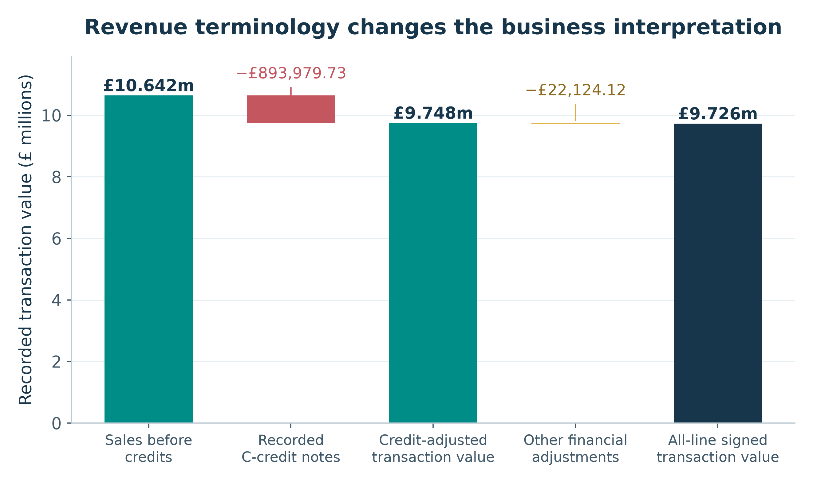

**Figure 2. Sales, credits and other adjustments**

**Interpretation.** Three valid transaction-value bases coexist. The all-line signed amount is £9,726,006.95, not the before-credit sales figure. The bridge explains the numerical difference instead of choosing an ambiguous “net revenue” label.

Source: outputs/exclusive_line_partitions.csv; outputs/negative_price_exceptions.csv; outputs/metrics.json; scripts/verified_core.py, scripts/analyze.py and scripts/make_charts.py.

**Numerical observation.** £10,642,110.80 before credits becomes £9,748,131.07 after £893,979.73 in C-credit notes; the remaining financial adjustments total −£22,124.12.

**Business implication.** Use a reconciled finance/BI definition and retain an adjustment register before setting or comparing sales targets.


<!-- page break -->

### 12.2 Monthly demand with partial-month warning

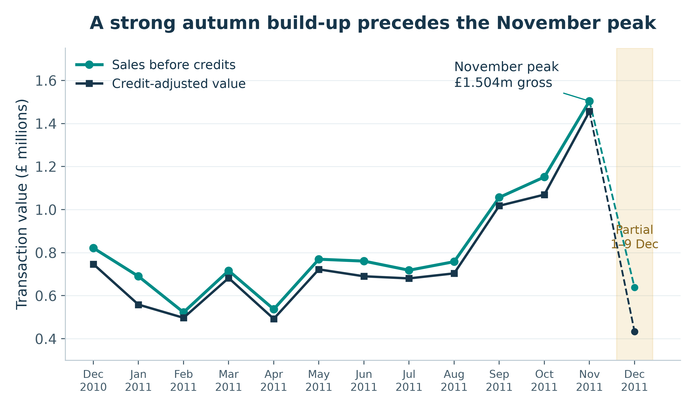

**Figure 3. Monthly demand with partial-month warning**

**Interpretation.** Gross and credit-adjusted series share a clear autumn increase, but the last data point is not a comparable full month. November growth of 30.63% is volume-led because invoice count rises faster than total sales.

Source: outputs/monthly_performance.csv; scripts/verified_core.py, scripts/analyze.py and scripts/make_charts.py.

**Numerical observation.** November 2011 reaches £1,503,866.78 on 2,769 invoices; October is £1,151,263.73 on 2,040 invoices. December 2011 covers only 1–9 December.

**Business implication.** Validate the pattern on fresh multi-year data, then test capacity and availability plans rather than extrapolating a nine-day month.


<!-- page break -->

### 12.3 Credit frequency and value severity are different

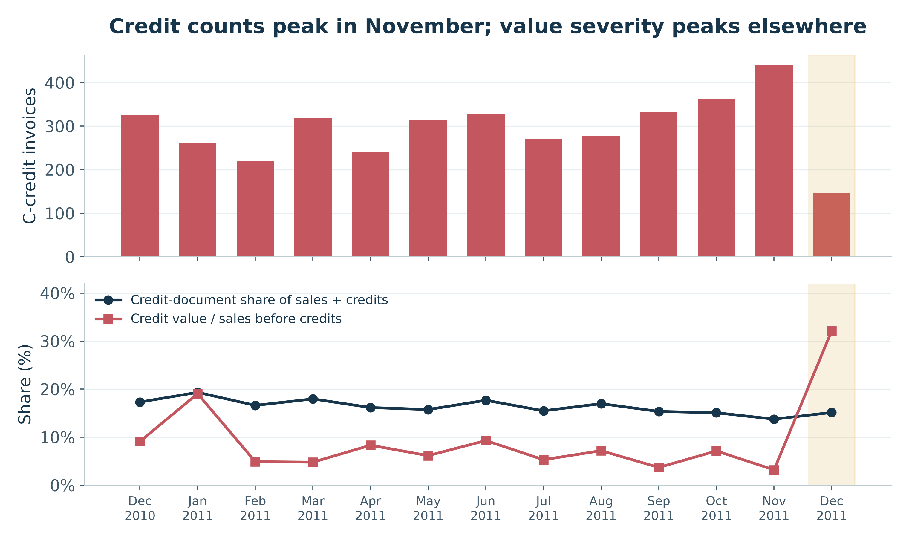

**Figure 4. Credit frequency and value severity are different**

**Interpretation.** Counts alone rank exposure differently from value-weighted severity. Monthly credits may relate to sales from earlier periods; credit value divided by same-month sales is a period activity ratio, not a cohort return rate. The large January and December offset pairs and partial-month coverage also matter.

Source: outputs/monthly_performance.csv; outputs/extreme_transaction_pairs.csv; scripts/verified_core.py, scripts/analyze.py and scripts/make_charts.py.

**Numerical observation.** November has the most C-credit documents (441) but credit value is 3.17% of its sales. January’s ratio is 19.04%; partial December’s is 32.16%.

**Business implication.** Monitor both credit-document share and credit value/sales, with reason codes and links to original invoices before interpreting a process failure.


<!-- page break -->

### 12.4 Customer concentration on the identified-sales basis

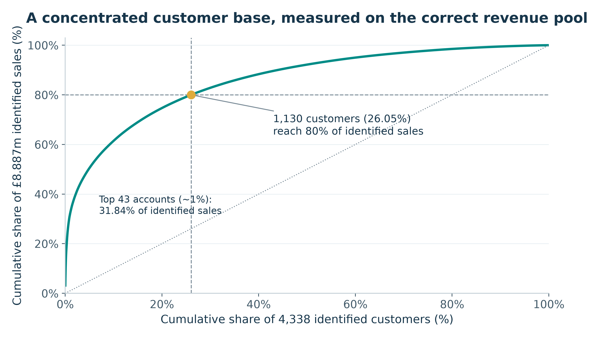

**Figure 5. Customer concentration on the identified-sales basis**

**Interpretation.** Value is concentrated, but the observed threshold is not an exact 80/20 rule. Anonymous sales (£1,754,901.91) sit outside this customer curve, so concentration cannot be asserted for every real purchaser.

Source: outputs/customer_pareto.csv; outputs/customer_rfm.csv; outputs/metrics.json; scripts/verified_core.py, scripts/analyze.py and scripts/make_charts.py.

**Numerical observation.** 1,130 customers (26.05% of 4,338) reach 80% of £8,887,208.89 identified sales. The top 43 IDs contribute 31.84% of that pool.

**Business implication.** Validate current major accounts and credit quality; maintain service coverage without assuming a rank is a lifetime-value estimate.


<!-- page break -->

### 12.5 RFM segment size versus value contribution

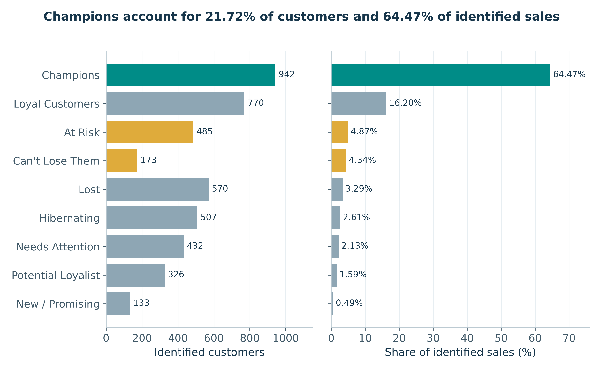

**Figure 6. RFM segment size versus value contribution**

**Interpretation.** Segment headcount and commercial value differ substantially. The segment shares use identified before-credit sales; Champions’ share of all qualified sales is 53.84%. RFM labels are heuristic and tie-dependent.

Source: outputs/rfm_segments.csv; outputs/customer_rfm.csv; scripts/verified_core.py, scripts/analyze.py and scripts/make_charts.py.

**Numerical observation.** Champions number 942 (21.72% of identified purchasers) and supply 64.47% of known sales. At Risk plus Can’t Lose Them contains 658 IDs.

**Business implication.** Refresh contact eligibility, credit-adjusted balances and segment rules before retention or win-back tests. Do not call all historic segment value recoverable.


<!-- page break -->

### 12.6 Product leaders before and after recorded credits

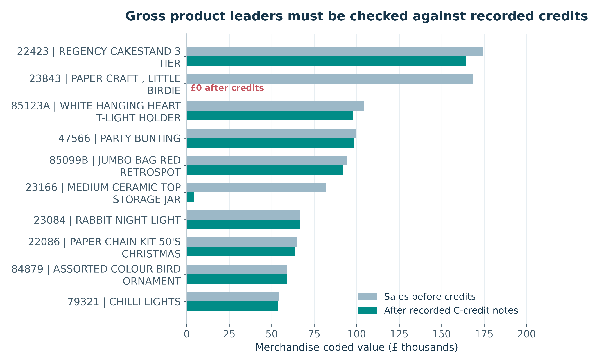

**Figure 7. Product leaders before and after recorded credits**

**Interpretation.** A gross-only catalogue ranking can overstate recorded credit-adjusted transaction value. Two conspicuous bulk transactions are fully offset, but the records remain valid observations in their respective sales/credit views.

Source: outputs/product_performance.csv; outputs/extreme_transaction_pairs.csv; scripts/verified_core.py, scripts/analyze.py and scripts/make_charts.py.

**Numerical observation.** 23843 falls from £168,469.60 to £0.00; 23166 falls from £81,700.92 to £4,221.28. 22423 has £164,459.49 after recorded credits.

**Business implication.** Use credit-aware SKU measures plus stock, margin and lead-time data before changing replenishment or promotions.


<!-- page break -->

### 12.7 Leading non-UK countries

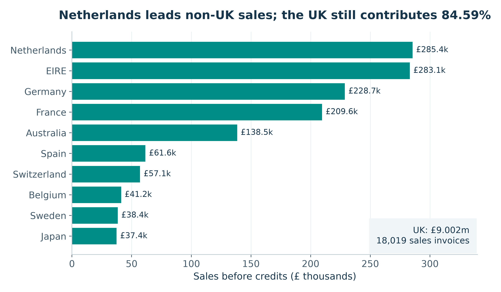

**Figure 8. Leading non-UK countries**

**Interpretation.** The bar chart isolates export comparisons that would otherwise be compressed by UK dominance. Netherlands’ large value does not imply broad customer depth: its top account is 98.16% of identified country sales.

Source: outputs/country_performance.csv; scripts/verified_core.py, scripts/analyze.py and scripts/make_charts.py.

**Numerical observation.** Netherlands leads at £285,446.34, followed by EIRE £283,140.52, Germany £228,678.40 and France £209,625.37. UK sales are £9,001,744.09.

**Business implication.** Separate key-account protection from geographic acquisition. Compare customer breadth and delivered margin before proposing expansion.


<!-- page break -->

### 12.8 Invoice-value histogram: mean versus typical order

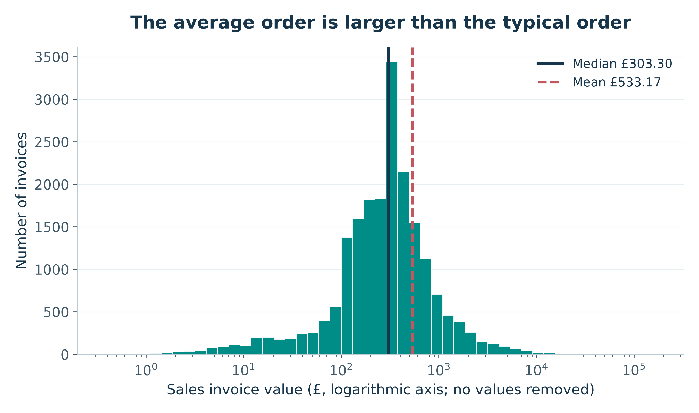

**Figure 9. Invoice-value histogram: mean versus typical order**

**Interpretation.** The log x-axis preserves all positive invoices and makes the severe right tail visible. Equal-width log bins are counts in multiplicative intervals, not a linear-scale density. Mean and median represent different aspects of this distribution.

Source: outputs/invoice_summary.csv; outputs/valid_descriptive_statistics.csv; scripts/verified_core.py, scripts/analyze.py and scripts/make_charts.py.

**Numerical observation.** The complete 19,960-invoice distribution has mean £533.17, median £303.30, 99th percentile £4,821.17 and maximum £168,469.60.

**Business implication.** Report a median, IQR and tail percentiles alongside AOV; do not design standard service or demand assumptions around mean alone.


<!-- page break -->

### 12.9 Basket breadth versus invoice value

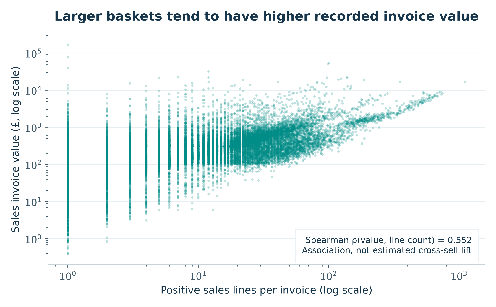

**Figure 10. Basket breadth versus invoice value**

**Interpretation.** Wider baskets tend to have larger values, with substantial dispersion and extreme observations on logarithmic axes. Line count is not necessarily distinct SKU count and is not an exogenous driver.

Source: outputs/invoice_summary.csv; outputs/invoice_spearman.csv; scripts/verified_core.py, scripts/analyze.py and scripts/make_charts.py.

**Numerical observation.** Across all qualified invoices, Spearman correlation between sales-line count and invoice value is 0.551606. Each plotted point represents one invoice; no point is sampled away.

**Business implication.** Treat basket-building as a hypothesis for a controlled test; do not translate correlation into a promised cross-sell percentage.


<!-- page break -->

### 12.10 Annotated Spearman correlation heatmap

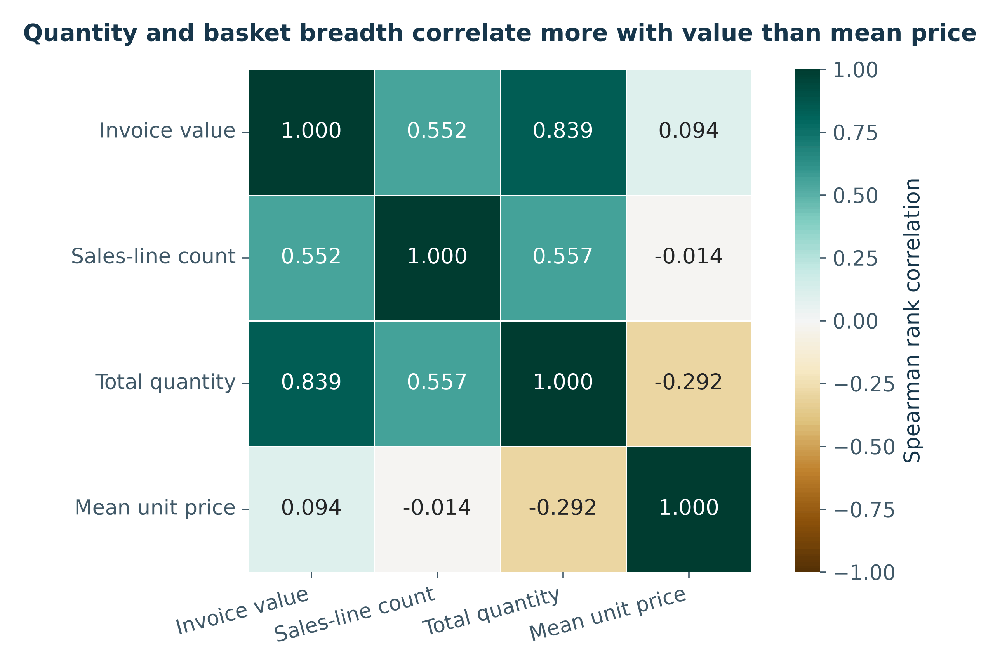

**Figure 11. Annotated Spearman correlation heatmap**

**Interpretation.** Quantity is more strongly rank-associated with recorded value than unweighted line mean price. These variables mechanically contribute to value and may reflect wholesale mix. Cyclic month/hour integers and customer IDs are excluded from the numerical heatmap.

Source: outputs/invoice_spearman.csv; outputs/invoice_summary.csv; scripts/verified_core.py, scripts/analyze.py and scripts/make_charts.py.

**Numerical observation.** Value correlates 0.838984 with total quantity, 0.551606 with sales-line count and 0.094257 with unweighted mean unit amount.

**Business implication.** Investigate quantity/basket mix and unit economics using proper margin and experimental evidence; the heatmap is not a price-optimisation model.


<!-- page break -->

### 12.11 Weekday sales and first-recorded invoice hour

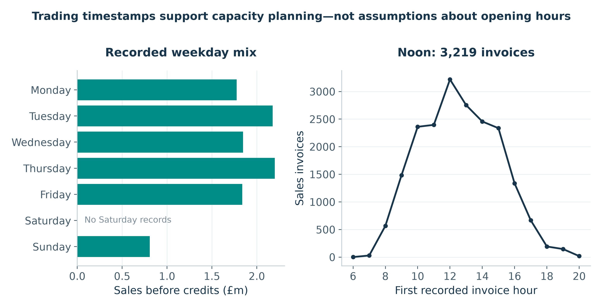

**Figure 12. Weekday sales and first-recorded invoice hour**

**Interpretation.** Mutually exclusive earliest-timestamp allocation fixes double counting from invoices that span two line-recording minutes. The aggregate time profile is a billing-data description, not proof of opening hours, labour load or fulfilment times.

Source: outputs/weekday_performance.csv; outputs/hourly_performance.csv; outputs/invoice_timestamp_exceptions.csv; scripts/verified_core.py, scripts/analyze.py and scripts/make_charts.py.

**Numerical observation.** Thursday contributes £2,199,292.57; noon starts 3,219 qualified invoices. There are no Saturday records in the workbook.

**Business implication.** Compare fresh operational timestamps, order processing effort and service levels before scheduling staff or systems capacity.


<!-- page break -->

### 12.12 Box plot of UK and non-UK invoice values

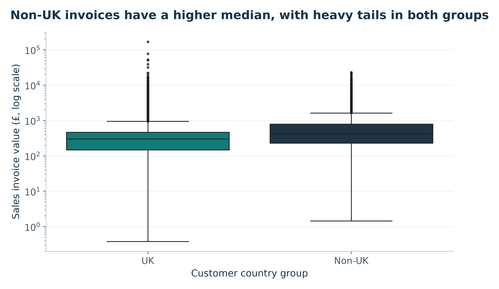

**Figure 13. Box plot of UK and non-UK invoice values**

**Interpretation.** Both groups have substantial high-value tails. Whiskers use 1.5×IQR on the original data, then the y-axis is displayed logarithmically. Outlier points remain. Invoice comparisons are descriptive because repeat customers contribute multiple observations.

Source: outputs/invoice_country_box_statistics.csv; outputs/invoice_summary.csv; scripts/verified_core.py, scripts/analyze.py and scripts/make_charts.py.

**Numerical observation.** UK median invoice value is £299.95 (Q1 £147.06; Q3 £465.315) versus non-UK £424.06 (Q1 £228.84; Q3 £790.54). Group sizes are 18,019 and 1,941 invoices.

**Business implication.** Prefer the customer-level comparison for conditional inference and evaluate delivery/margin constraints before treating larger foreign invoices as attractive acquisition economics.


<!-- page break -->

### 12.13 Count plot of observed customer purchase frequency

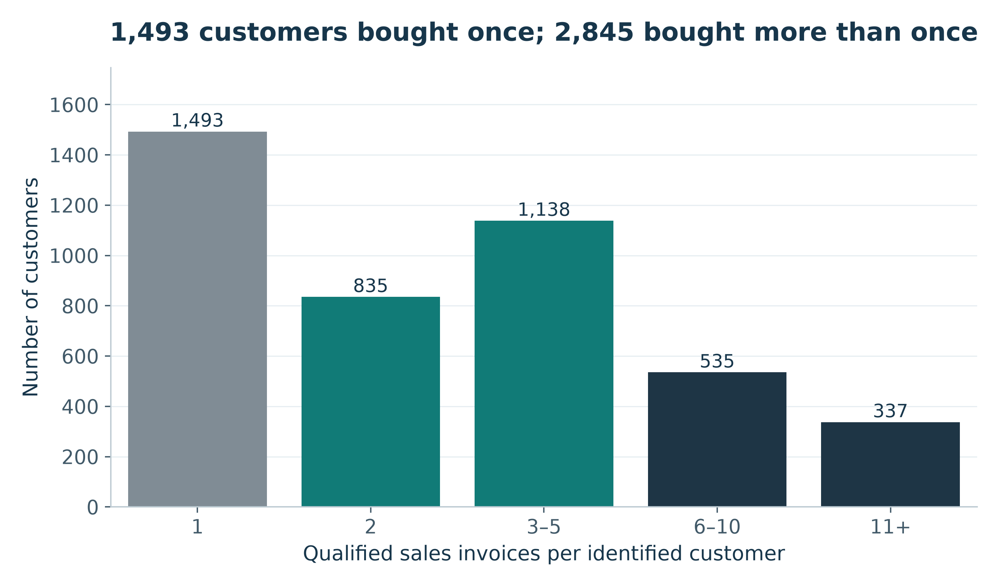

**Figure 14. Count plot of observed customer purchase frequency**

**Interpretation.** Each identified purchaser appears exactly once, so the bars sum to 4,338. The observed repeat majority does not remove acquisition-date censoring or missing-customer bias. A count plot is used instead of an unnecessary pie chart.

Source: outputs/customer_frequency_bands.csv; outputs/customer_rfm.csv; scripts/verified_core.py, scripts/analyze.py and scripts/make_charts.py.

**Numerical observation.** Frequency bands contain 1,493 customers with one invoice; 835 with two; 1,138 with 3–5; 535 with 6–10; and 337 with at least 11.

**Business implication.** Build exposure-adjusted cohorts from current customer data and measure repeat activity over a common follow-up window.


<!-- page break -->

### 12.14 Qualified line quantity and unit-amount distributions

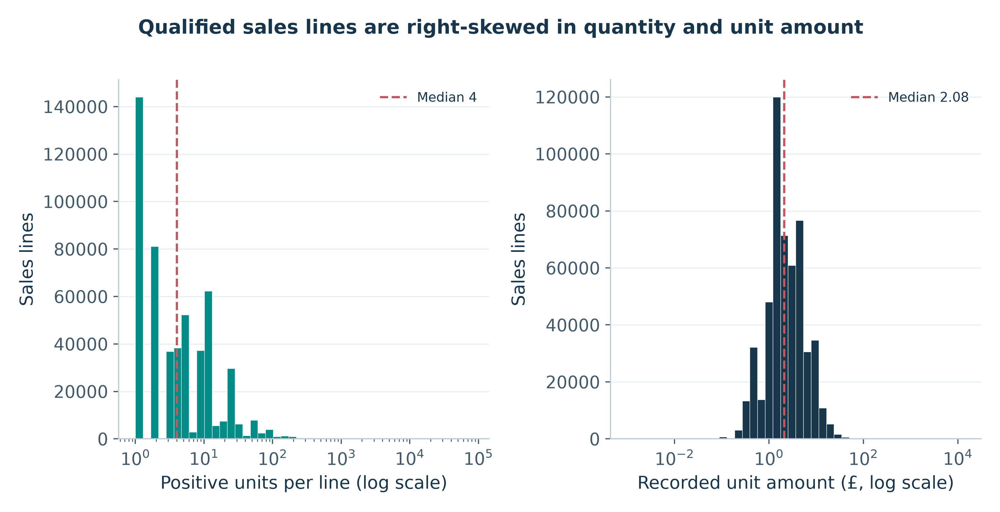

**Figure 15. Qualified line quantity and unit-amount distributions**

**Interpretation.** The two positive measures have very different units and long tails. Separate panels and logarithmic x-axes preserve every qualified line without implying quantity and currency are directly comparable. The unit-amount panel includes all qualified codes, including non-product entries.

Source: outputs/sales_line_measures.csv.gz; outputs/valid_descriptive_statistics.csv; scripts/verified_core.py, scripts/analyze.py and scripts/make_charts.py.

**Numerical observation.** Quantity median is 4, mean 10.616600 and maximum 80,995. Unit amount median is £2.08, mode £1.25 and qualified maximum £13,541.33.

**Business implication.** Use a merchandise-only, credit-aware demand layer for replenishment and retain an exception review for unusually large amounts rather than applying a universal cutoff.


<!-- page break -->

## 13. Key Findings and Original Insights

The following findings synthesize evidence rather than restating chart titles. Each provides a numerical comparison, meaning, business importance and recommended response. Detailed arithmetic and plots are in Sections 11–12; all evidence remains traceable to the original workbook.

### 13.1 Sales activity is not retained or accounting revenue

**Evidence and comparison.** Sales before credits are £10,642,110.80; C-credit notes are £893,979.73. The resulting £9,748,131.07 differs again from the £9,726,006.95 all-line signed amount after bad-debt adjustments.

**Meaning and importance.** The measurement basis changes the answer, not merely its wording. Ambiguous net-revenue labels would obscure credit exposure and inconsistent targets.

**Recommendation.** Publish the three separately defined measures and a signed adjustment bridge.

Evidence file: outputs/exclusive_line_partitions.csv; outputs/negative_price_exceptions.csv

### 13.2 Two fully offset bulk entries dominate credit severity

**Evidence and comparison.** The 581483/C581484 and 541431/C541433 pairs total £245,653.20 gross and zero signed pair value. They alone account for 27.48% of recorded C-credit value; 23843 goes from £168,469.60 to £0.00.

**Meaning and importance.** A small number of extreme records can alter product rankings and period credit ratios. Treating these gross values as replenishment demand or loyal-customer value would misallocate attention.

**Recommendation.** Prioritise traceable credit linkage and inspect large offsets without deleting authentic records or alleging a cause.

Evidence file: outputs/extreme_transaction_pairs.csv; outputs/product_performance.csv

### 13.3 AOV is materially above the typical invoice

**Evidence and comparison.** Mean invoice value is £533.17 versus median £303.30, with p99 £4,821.17. A hypothetical £183.60 line-value cap lowers total sales by 16.29%, much more than the 0.23% deduplication sensitivity.

**Meaning and importance.** The upper tail matters financially but does not justify arbitrary clipping. A mean-only view masks both normal-sized orders and exceptional exposure.

**Recommendation.** Use median/IQR/tail percentiles alongside AOV and retain credit-qualified extreme observations.

Evidence file: outputs/valid_descriptive_statistics.csv; outputs/metrics.json


<!-- page break -->

### 13.4 Identity coverage is a value-attribution limitation, not a reason to erase sales

**Evidence and comparison.** Anonymous qualified lines total 132,186 (25.18%) and £1,754,901.91. They supply 16.49% of all sales; known purchasers cover £8,887,208.89 (83.51%).

**Meaning and importance.** Line missingness and financial coverage differ; a quarter of lines missing an ID does not mean a quarter of sales value is missing. RFM and repeat findings cannot represent the complete purchaser population, and missingness may be selective.

**Recommendation.** Retain anonymous transactions in finance/time views and improve permissioned prospective identity linkage.

Evidence file: outputs/metrics.json; outputs/raw_schema_profile.csv

### 13.5 Repeat activity does not imply a larger mean order

**Evidence and comparison.** Repeat purchasers number 2,845 of 4,338 (65.58%). Mean customer AOV is £421.00 for repeat versus £411.25 for one-time purchasers (Welch p 0.8732), while medians are £302.56 and £255.91 and the rank test differs.

**Meaning and importance.** Mean, median and distributional questions produce different evidence; non-significance is not equivalence. Retention economics may depend on frequency and credit-qualified contribution, not automatically higher mean AOV.

**Recommendation.** Test retention effects using current cohorts, common follow-up and appropriate contribution metrics.

Evidence file: outputs/customer_rfm.csv; outputs/metrics.json

### 13.6 Customer concentration is strong but denominator-sensitive

**Evidence and comparison.** Champions are 942 IDs (21.72%) producing £5,729,483.37. This is 64.47% of identified sales but only 53.84% of all sales; 1,130 IDs, not exactly 20%, reach 80% of the identified pool.

**Meaning and importance.** The retailer has concentrated known-account value, not a universal 80/20 law. Ignoring anonymous sales or credit balances overstates the reach and certainty of a CRM list.

**Recommendation.** Refresh key accounts, display both denominators and validate current credit-adjusted eligibility.

Evidence file: outputs/rfm_segments.csv; outputs/customer_pareto.csv


<!-- page break -->

### 13.7 A high gross customer ranking can disappear after credits

**Evidence and comparison.** Customer 16446 has £168,472.50 gross sales but £2.90 credit-adjusted; customer 12346 has £77,183.60 gross and £0.00 adjusted. Twenty-one purchasers have a non-positive penny-rounded adjusted balance in the observation window.

**Meaning and importance.** Gross-only RFM can label large reversed transactions as customer value. This risks inappropriate incentives, but the balances do not identify lifetime loss or misconduct.

**Recommendation.** Supplement rather than silently overwrite gross RFM with transparent credit-adjusted review flags.

Evidence file: outputs/customer_rfm.csv; outputs/extreme_transaction_pairs.csv; outputs/extended_results.json

### 13.8 Win-back scope is historical exposure, not recoverable revenue

**Evidence and comparison.** At Risk plus Can’t Lose Them includes 658 purchasers and £818,896.54 of historical gross value. Recorded customer credits reduce that to £736,853.23; one member has a non-positive adjusted balance.

**Meaning and importance.** A segment total describes what was recorded, not what an outreach campaign can recapture. Presenting it as forecast recovery would invent conversion, permission and uplift assumptions.

**Recommendation.** Validate fresh permissions, exclude unresolved credit issues and measure a holdout-based campaign before scaling.

Evidence file: outputs/customer_rfm.csv; outputs/rfm_segments.csv; outputs/metrics.json

### 13.9 Country value can represent one account rather than market breadth

**Evidence and comparison.** The UK generates £9,001,744.09 (84.59% of sales); Netherlands leads non-UK at £285,446.34. The leading Netherlands account supplies 98.16% of identified country sales across nine known IDs, while Germany has 94 and France 87 known purchasers.

**Meaning and importance.** High national sales and broad demand are different dimensions. Account loss could dominate the apparent national opportunity; acquisition economics remain unknown.

**Recommendation.** Protect current account relationships separately from small, cost-qualified market-expansion tests.

Evidence file: outputs/country_performance.csv


<!-- page break -->

### 13.10 The November peak is invoice-volume-led

**Evidence and comparison.** November sales of £1,503,866.78 exceed October by 30.63%. Invoice count rises 35.74% (2,040 to 2,769), while AOV falls 3.76% (£564.34 to £543.11).

**Meaning and importance.** More invoices, not higher average invoice value, explain the growth identity. A price-increase interpretation would misdirect peak planning; the nine-day December observation is also not comparable.

**Recommendation.** Validate current invoice workload, product availability and capacity before planning the next peak.

Evidence file: outputs/monthly_performance.csv

### 13.11 Foreign customer AOV is higher, without a stronger repeat signal

**Evidence and comparison.** Mean customer AOV is £661.12 non-UK versus £391.68 UK; Welch p = 5.55×10⁻⁸, d = −0.150 for UK minus non-UK. Repeat shares are almost equal, 65.79% versus 65.56%, with Yates p = 0.9687.

**Meaning and importance.** Higher invoice values and observed repeat share within the recorded window need not move together. Country mix, costs, selection and tenure could explain patterns; neither comparison estimates a geography effect.

**Recommendation.** Compare delivered contribution and customer exposure before prioritising a country; test rather than infer causation.

Evidence file: outputs/customer_rfm.csv; outputs/country_repeat_contingency.csv; outputs/extended_results.json

### 13.12 Basket associations suggest hypotheses, not demonstrated uplift

**Evidence and comparison.** Spearman value–quantity correlation is 0.838984 and value–line-count is 0.551606. Value–unweighted-mean-unit-amount correlation is only 0.094257; 825 of 3,912 merchandise codes reach 80% of merchandise gross sales.

**Meaning and importance.** Basket mix and product concentration are operationally relevant, but value is mechanically constructed from quantity and price. A heatmap cannot establish that increasing quantity or recommendations will improve profit.

**Recommendation.** Use credit-aware catalogue priorities and a pre-specified bundle/recommendation test with margin and credit guardrails.

Evidence file: outputs/invoice_spearman.csv; outputs/product_pareto.csv; outputs/metrics.json


<!-- page break -->

## 14. Business Recommendations

The eight recommendations are proposals, not completed interventions. Expected benefits describe mechanisms rather than invented savings or uplift. Owners, sequence and decision gates are suggested for implementation. Historical numeric baselines must be refreshed before current targets or experiments are approved.

### 14.1 Reconcile finance definitions and implement credit traceability

**Problem and evidence.** £10.642m before-credit sales, £9.748m credit-adjusted value and £9.726m all-line signed value are different. Two offset pairs represent 27.48% of credit value.

**Action and owner.** Create a versioned metric dictionary; retain all signed records; add an original-invoice link, reason code and exception queue to each new credit. Review large matched offsets before performance reporting. Proposed owner: Finance lead with BI/data engineering.

**Expected benefit, not a measured outcome.** Less misclassification of sales and more interpretable credit exposure; no financial saving is established by this dataset.

**Measurement and decision gate.** Reconciliation residual should equal £0.00 at the documented rounding basis. Measure credit-link coverage, missing reason-code share and exception age; the source lacks the first two baselines, so establish them on new data rather than inventing them.

### 14.2 Improve permissioned customer attribution without dropping anonymous activity

**Problem and evidence.** 132,186 qualified lines lack an ID; £1,754,901.91 (16.49% of sales) cannot be assigned to a known purchaser.

**Action and owner.** Audit checkout and CRM linkage, preserve valid anonymous transactions and add optional, consent-compliant identifier capture with ID quality checks. Do not infer identity from purchase resemblance. Proposed owner: CRM operations and data engineering with privacy review.

**Expected benefit, not a measured outcome.** Broader, more representative CRM measurement while preserving full commercial totals and appropriate privacy choices.

**Measurement and decision gate.** Track both known-sales value coverage (historical 83.51%) and missing-ID line share (25.18% in qualified sales). Report weekly changes with a fresh baseline and monitor abandoned checkout/consent complaints; do not set forced identity capture as the success condition.


<!-- page break -->

### 14.3 Protect validated high-value accounts before generic promotions

**Problem and evidence.** 942 Champions provide 64.47% of identified sales, but gross value can be misleading: customer 16446 has only £2.90 after recorded credits.

**Action and owner.** Refresh the RFM window, permissions, account status and credit-adjusted balances; review high-concentration accounts with service teams. Keep gross and adjusted versions visible, and use a holdout where contact is discretionary. Proposed owner: Account management and CRM analytics.

**Expected benefit, not a measured outcome.** More relevant service and less incentive spend on reversed activity. Improved retention is possible but not demonstrated.

**Measurement and decision gate.** Measure current qualified repeat activity, credit-adjusted contribution per eligible account, service issues and opt-outs over a common follow-up period. Pre-specify treatment/control and decision criteria after costs and sample size are known; do not promise an uplift.

### 14.4 Use a bounded, eligibility-checked win-back pilot

**Problem and evidence.** 658 At Risk/Can’t Lose Them IDs represent £736,853.23 of adjusted historical value, not recoverable sales; one has a non-positive adjusted balance.

**Action and owner.** Revalidate current contact permission and trading status, resolve credits first and draw a small randomized eligible pilot with a business-as-usual holdout. Use recent recency/frequency definitions, not 2011 labels operationally. Proposed owner: CRM campaign manager and analyst.

**Expected benefit, not a measured outcome.** Tests whether outreach adds incremental, retained value without presenting historical exposure as a forecast.

**Measurement and decision gate.** Primary outcome: net-of-credit contribution per eligible assigned customer; secondary outcomes: repeat purchase, opt-outs and campaign cost. Set follow-up, minimum detectable effect and sample size from current data. Publish confidence intervals and costs before scaling.


<!-- page break -->

### 14.5 Prioritise credit-aware merchandise and integrate inventory economics

**Problem and evidence.** 23843 has £168,469.60 gross but £0.00 adjusted; 22423 has £164,459.49 after recorded credits. A set of 825 of 3,912 merchandise codes reaches 80% of gross merchandise value.

**Action and owner.** Build a SKU scorecard with gross/credit-adjusted value, units, credit incidence, availability, margin and supplier lead time. Separate postage/manual codes. Investigate reversed bulk entries rather than treating them as ordinary replenishment demand. Proposed owner: Merchandising and supply planning.

**Expected benefit, not a measured outcome.** Better prioritisation of stock reviews and less gross-ranking distortion; reduced stock-outs or cash tied in inventory cannot be quantified from these data.

**Measurement and decision gate.** With inventory/cost data, monitor fill rate, stock-out days, contribution after credits and inventory turns by priority SKU. Compare against an agreed baseline and keep availability changes separate from demand changes.

### 14.6 Plan peak workload from invoice volume, then validate operational effort

**Problem and evidence.** November invoice count increases 35.74% while AOV declines 3.76%; the modal recorded start hour is noon with 3,219 invoices across the extract.

**Action and owner.** Refresh multiple years of demand and join warehouse/service timestamps. Stress-test invoice-processing and fulfilment capacity for observed order-count variation; separate billing times from physical workload. Proposed owner: Operations manager with analytics and systems teams.

**Expected benefit, not a measured outcome.** A workload-led capacity plan is better aligned with the observed growth pattern than a price-led story, but no staffing saving or service improvement has been measured.

**Measurement and decision gate.** Use current invoices/hour, processing minutes/order, backlog, on-time dispatch and error rate. Set service-level and capacity gates using current workload; explicitly compare complete months and avoid extrapolating the partial December record.


<!-- page break -->

### 14.7 Separate key-account protection from geographic expansion

**Problem and evidence.** Netherlands leads non-UK value (£285,446.34) but one account supplies 98.16% of identified country sales; Germany/France show broader historical customer counts (94/87).

**Action and owner.** Review current Netherlands and Australia key accounts separately from market-acquisition opportunities. For any expansion pilot, obtain shipping, tax, returns and landed-margin data and cap pilot exposure under approved budgets. Proposed owner: Commercial lead, account manager and finance.

**Expected benefit, not a measured outcome.** Makes concentration risk explicit and avoids mistaking one buyer’s demand for a broad national market.

**Measurement and decision gate.** Track top-account share, active buyer breadth, delivered contribution, repeat activity, credit value and acquisition cost. Expansion passes a pre-agreed contribution/retention gate on current data, not simply a country gross-sales rank.

### 14.8 Test basket-building rather than monetising correlation

**Problem and evidence.** Value–line-count Spearman 0.551606 and value–quantity 0.838984 suggest basket hypotheses, while repeat/one-time mean AOV differs little under Welch (p 0.8732).

**Action and owner.** Develop plausible complementary-product suggestions using merchandise transactions, then randomize eligible customers or sessions if appropriate data become available. Pre-register the outcome, assignment unit, exclusions and credit follow-up. Proposed owner: Product/merchandising team with experimentation analyst.

**Expected benefit, not a measured outcome.** Can distinguish incremental contribution from selection and larger-basket mechanics; no observed cross-sell lift or price elasticity is claimed.

**Measurement and decision gate.** Measure contribution per assigned unit, conversion only if session denominators exist, credit-adjusted AOV, credit incidence and opt-outs. Compute a current-data power plan and report effect intervals. Stop or revise if margin/credit guardrails deteriorate.

### 14.9 Suggested sequence and dependencies

First agree the metrics and credit/identity controls (R1–R2), then refresh current customer and product data (R3–R5). Operational and geographic pilots (R6–R7) require workload/cost information. Basket testing (R8) requires a valid assignment and outcome dataset. The sequence is proposed; no workstream has been implemented and no schedule, ROI or improvement percentage is presented as an observed result.


<!-- page break -->

## 15. Limitations

**Table 29. Limitations, consequences and mitigations**

| Limitation | Consequence for this analysis | Mitigation / honest boundary |

| --- | --- | --- |

| Historical, single-retailer extract | 2010–2011 patterns cannot establish current commercial priorities or sector-wide performance. | Refresh current, multi-year data before action; preserve case-study wording. |

| Partial final month | December 2011 contains only 1–9 December. | Label coverage and exclude it from full-month growth interpretation; do not annualise nine days. |

| Missing customer identities | 24.93% of raw lines and 16.49% of qualified sales value cannot be assigned to purchasers. | Retain sales, restrict customer denominators and avoid representativeness claims. |

| Exact-duplicate assumption | Identical source rows might sometimes represent legitimate repeated entries. | Preserve original and show £24,573.74 no-dedup sales sensitivity. |

| No complete credit/order links | Only selected exact offset pairs are identified; general cancellation probabilities or causes are unknown. | Describe C-credit documents and value ratios; add operational links and reason codes prospectively. |

| No costs, margins or fulfilment | Recorded value is not profit, cash collection, inventory demand fulfilled or delivered contribution. | Do not claim ROI; acquire economics and operational data for decisions. |

| Mixed code semantics | Non-product code list is analyst-defined and descriptions vary. | Publish the list; use StockCode; validate with a business-owned catalogue. |

| Dependent and non-random observations | Invoices repeat by customer and time; country groups are not random assignments. | Use customer-level summaries for primary comparisons; treat tests as conditional exploratory evidence. |

| Skew and extreme entries | Means and t intervals are tail-sensitive; some extremes fully offset. | Report median/IQR/tails, rank sensitivity and credits; no arbitrary removal. |

| RFM heuristics and exposure | Tie-breaking, gross monetary basis and acquisition-date censoring affect labels and repeat opportunity. | Document exact rules; refresh and validate segments/cohorts before use. |

| Country and timestamp conventions | Eight IDs span country labels; 42 invoices span line timestamps; timezone unavailable. | Declare first-country and earliest-invoice-time rules; retain original labels/timestamps. |

| Exploratory tests and no intervention | Multiple comparisons are unadjusted; causal effects, improvement and generalisation are unidentified. | Pre-register future tests, use appropriate assignment and never equate association with causation. |


Public education data may still carry privacy or re-identification risks; numeric CustomerID is not proof that no real-world person could ever be linked. Current customer activation would require lawful access and permission checks. Dataset licensing does not replace those operational obligations. [2]


<!-- page break -->

## 16. Future Scope

Further work should reduce an identified uncertainty rather than add an impressive but unsupported model. Each proposed extension below depends on additional data or a stricter design; none is presented as already executed.

**Table 30. Specific extensions and evidence needed**

| Extension | Required data / design | Output and decision value |

| --- | --- | --- |

| Exposure-adjusted customer cohorts | Acquisition dates, recent customer history, consistent follow-up and permissioned IDs. | Repeat/retention curves with censoring handled; distinguish tenure from behaviour. |

| Credit linkage and root-cause analysis | Original invoice references, reason codes, dispatch/refund dates and resolution status. | Linked-order credit incidence, causes and time-to-credit; targeted process fixes. |

| Credit-aware customer value | Costs, delivery, acquisition/service expense and sufficiently long current history. | Contribution-based account priorities; validate against gross RFM rather than relabel sales as CLV. |

| Inventory and SKU planning | Stock availability, lead time, stock-outs, supplier cost and product master. | Credit-adjusted ABC/XYZ and service-level planning; distinguish suppressed sales from low demand. |

| Forecasting with honest validation | Multiple complete years, promotions, holidays and rolling-origin holdouts. | Backtested forecast intervals, error by peak/normal periods and comparison with simple baselines. |

| Basket and market experiments | Eligible population, assignment logs, sessions if conversion is needed, costs and credit follow-up. | Incremental contribution with uncertainty and guardrails; no inference from correlation alone. |

| Robust uncertainty and sensitivity | Current customer clusters, time blocks and prespecified estimands. | Cluster-aware/temporal resampling, trimmed estimates and test multiplicity control for planned questions. |


Unsupervised segmentation or supervised prediction would require an explicit use case, leakage controls, time-based validation and a baseline. A cluster label is not a business insight by itself, and a forecast score does not replace interpretable reconciliation. The immediate priority is better identifiers, linked credits and unit economics, because those gaps directly limit the decisions discussed in this report.


<!-- page break -->

## 17. Conclusion

The unchanged UCI workbook supports a complete, auditable transaction analysis when its mixed processes and analytical grains are kept explicit. From 541,909 original lines, a documented exact-duplicate assumption yields 536,641 complete cleaned records. Qualified sales remain a separate 524,878-line view representing 19,960 invoices, while anonymous activity, credits, non-credit stock movements and bad-debt adjustments remain traceable in the full cleaned data.

The principal measurement answer is £10,642,110.80 sales before credits, £893,979.73 recorded C-credit value and £9,748,131.07 credit-adjusted value. The £9,726,006.95 all-line signed total reconciles the additional financial adjustments. A typical invoice is much closer to the £303.30 median than the £533.17 mean. Two completely offset extreme pairs show why before-credit rankings alone are insufficient for product or account decisions.

Customer and geographic conclusions require denominator discipline. Identified purchasers supply 83.51% of sales; their repeat share is 65.58%. Champions contribute 64.47% of that identified pool but 53.84% of all sales. The UK dominates at 84.59%, while Netherlands’ leading non-UK value is highly concentrated in one account. November’s peak is explained by higher invoice volume despite lower AOV; partial December cannot be read as a full-month decline.

These results justify credit-aware measurement controls, permissioned identity improvement, current-data account/SKU validation and carefully designed operational, geographic and basket pilots. They do not establish profit, causal drivers, campaign recovery, fraud or present-day performance. Statistical tests are exploratory and conditional; recommendations remain proposed actions with measurable decision gates.

The five reviewer criticisms are addressed through fourteen fully worked examples, complete raw/cleaned profiles, step-level code and before/after cleaning evidence, fifteen interpreted figures, twelve numerically supported findings and eight practical recommendations. Full computational code, an executed notebook, cleaned-data manifests and validation evidence accompany this report. Submission quality is designed to support a strong evaluation; the official score remains the evaluator’s decision, not a promised 90+ result.


<!-- page break -->

## 18. References

[1] Chen, D. (2015). Online Retail [Dataset]. UCI Machine Learning Repository. DOI: 10.24432/C5BW33. Official catalogue, business description, variables, file and licence.
https://archive.ics.uci.edu/dataset/352/online+retail

[2] Creative Commons. Attribution 4.0 International (CC BY 4.0). Attribution, changes, no endorsement and other-rights notices.
https://creativecommons.org/licenses/by/4.0/

[3] Pandas development team. Pandas 2.2.3 documentation: DataFrame.describe. Numeric/categorical descriptions and default percentiles.
https://pandas.pydata.org/pandas-docs/version/2.2/reference/api/pandas.DataFrame.describe.html

[4] SciPy community. scipy.stats.ttest_ind documentation, stable web manual (1.18.0 when consulted). Independent-sample null, unequal-variance Welch option and inferential interpretation. Installed runtime: SciPy 1.17.1.
https://docs.scipy.org/doc/scipy/reference/generated/scipy.stats.ttest_ind.html

[5] Seaborn. seaborn.boxplot, version 0.13.2 documentation. Quartiles, 1.5×IQR whiskers and outlier display.
https://seaborn.pydata.org/generated/seaborn.boxplot.html

[6] Reddy, T. A. Original Task 4 Online Retail project, repository snapshot e05584ebc7fd1193a83130539ac94cba90d6a6f2. Used for baseline-method comparison only; not an independent source of revised evidence.
https://github.com/appureddy1102-cloud/real-world-online-retail-analysis

Source documents consulted for this revision: 7 November 2026. All numerical findings in this report are original computations on the provided official workbook; external documentation supports source definitions, licensing and method use, not the empirical results. No unread paper is cited as evidence for these findings. The source archive is https://archive.ics.uci.edu/static/public/352/online+retail.zip.

Evidence file: data/source_verification.json; references/task4_original_results.json; outputs/task4_metric_reconciliation.csv


<!-- page break -->

## 19. Appendix – Python Code

### 19.1 Reproduce the project

Run from the project root in a Python virtual environment. Analysis uses the included original workbook; if it is absent, the core downloads the official UCI archive and verifies the same SHA-256. Python 3.13.16 and the exact installed dependencies are recorded in requirements.txt. No credentials or connector access are needed to recompute results or figures.

```python
python -m venv .venv
# Linux/macOS: source .venv/bin/activate
# Windows PowerShell: .venv\Scripts\Activate.ps1
python -m pip install -r requirements.txt
python scripts/analyze.py
python scripts/make_charts.py
python scripts/run_notebook.py
python tests/validate_outputs.py
```

For editable Word regeneration, run python scripts/build_report.py, then refresh the contents and page fields in Writer/Word. The optional Linux publishing route is documented in README.md and scripts/format_document.py; it requires LibreOffice Writer and the system UNO bridge. The final Word file was rendered with LibreOffice for layout checks, not tested inside the Microsoft Word application. Publishing is separate from recomputation.

### 19.2 Actual execution outputs and evidence map

```python
gross_sales: 10642110.8
credit_value_abs: 893979.73
credit_adjusted_value: 9748131.07
dedup_signed_all_lines: 9726006.95
PASS: 24 Task 4 metric reconciliations; all aggregation and partition checks.
Extended exploration complete: [536641, 16] cleaned-all; [524878, 16] qualified sales
Description whitespace normalized: 112371 | Country whitespace: 0
Worked standard deviation: 0.8944271909999159
Worked Pearson r: 0.9952659485651739
Worked Welch t: -5.474116123522671 | df: 1008.1829680542309
Charts: 15
```

**Table 31. Evidence outputs and their purpose**

| Output family | Contents |

| --- | --- |

| raw_schema_profile; raw/valid_descriptive_statistics | Complete schema/missing/unique and mean/median/mode/sample SD/min/max/quartile summaries. |

| cleaning_step_audit; cleaned_schema; manifests | Before/after operations, literal core expressions, final columns and file hashes. |

| worked_invoice; worked_standard_deviation; worked_pearson | Source-derived rows for manual calculations in Section 11. |

| monthly/country/product/customer summaries | Complete aggregates underlying insights, charts and recommendations. |

| extreme_transaction_pairs; exceptions | Auditable offset, bad-debt and timestamp observations. |

| metrics; extended_results; reconciliation | Machine-readable results, worked statistical inputs and 24 reproduced baseline checks. |

| report_manifest; QA_REPORT; VALIDATION | Report structure, evidence/figure registers and executed package checks. |


<!-- page break -->

### 19.3 Read the complete cleaned datasets correctly

```python
from pathlib import Path
import pandas as pd

root = Path.cwd()
dtypes = {
    'InvoiceNo': 'string', 'StockCode': 'string', 'Description': 'string',
    'Country': 'string', 'CustomerID': 'Int64', 'SourceRow': 'int64',
    'IsCredit': 'boolean', 'IsNonProduct': 'boolean',
    'IsOtherNegativeMovement': 'boolean', 'HasCustomerID': 'boolean',
    'IsQualifiedSale': 'boolean', 'Month': 'string',
}
clean = pd.read_csv(root/'data/cleaned_all_records.csv.gz',
                    dtype=dtypes, parse_dates=['InvoiceDate'])
sales = clean.loc[clean.IsQualifiedSale].copy()
assert clean.shape == (536641, 16)
assert sales.shape == (524878, 16)
assert clean.SourceRow.is_unique
assert clean.CustomerID.isna().sum() == 135037
print(clean.shape, sales.shape)
print(round(sales.LineValue.sum(), 2))
```

Actual read-back output: (536641, 16) (524878, 16), then 10642110.8. CSV empty CustomerID cells mean missing, not zero. The UNKNOWN Description sentinel denotes a missing label. SourceRow joins to the original workbook, so the retained normalized record can always be inspected without changing the source.

### 19.4 Full computational source

The following three files are reproduced in full, with imports, comments and executable statements. They are separate files: save each under its stated scripts/ path, rather than concatenating them. Long code lines may visually wrap; paragraph boundaries preserve the original source line. Report-generation, notebook-runner and validation utilities are included in the companion project as additional source.


<!-- page break -->

### 19.4.1 scripts/verified_core.py — verified source, partitions, aggregates and tests

```python
"""Verified computational core for the revised YuvaIntern Task 4 project.

Run from any directory: python scripts/analyze.py
Downloads the official workbook when absent, verifies its SHA-256, reproduces
Task 4's valid-sales basis, and exports corrected, explicitly scoped measures.
No synthetic transactions, forecasts or intervention results are generated.
"""
from __future__ import annotations

import hashlib
import io
import json
import math
import platform
import zipfile
from datetime import datetime, timezone
from pathlib import Path

import numpy as np
import pandas as pd
import requests
from scipy import stats

ROOT = Path(__file__).resolve().parents[1]
DATA = ROOT / "data"
OUT = ROOT / "outputs"
CACHE = ROOT / ".cache"
for directory in (DATA, OUT, CACHE):
    directory.mkdir(parents=True, exist_ok=True)
SOURCE = "https://archive.ics.uci.edu/static/public/352/online+retail.zip"
EXPECTED_SHA256 = "43465a06f2ccf7c8b5bd2892bc7defb52f97487934fe93b16ae4c3936424676d"
NON_PRODUCT = {
    "POST", "DOT", "M", "BANK CHARGES", "AMAZONFEE", "PADS", "D", "C2", "CRUK",
    "TEST001", "TEST002", "SAMPLES", "NOTES", "B", "S", "AMAZON", "CHECK", "COLLECT",
}
REFERENCE_DATE = pd.Timestamp("2011-12-10")


def rounded(x, digits=2):
    return round(float(x), digits)


def save(frame, filename, index=False):
    frame.to_csv(OUT / filename, index=index, float_format="%.8f")


def test_groups(a, b):
    a, b = np.asarray(a, float), np.asarray(b, float)
    t, p = stats.ttest_ind(a, b, equal_var=False)
    u, up = stats.mannwhitneyu(a, b, alternative="two-sided")
    pooled_sd = np.sqrt(((len(a)-1)*a.var(ddof=1) + (len(b)-1)*b.var(ddof=1)) / (len(a)+len(b)-2))
    return {
        "n_a": len(a), "n_b": len(b), "mean_a": rounded(a.mean()), "mean_b": rounded(b.mean()),
        "median_a": rounded(np.median(a)), "median_b": rounded(np.median(b)),
        "welch_t": rounded(t, 6), "welch_p": float(p),
        "cohens_d_a_minus_b": rounded((a.mean()-b.mean())/pooled_sd, 6),
        "mann_whitney_u": float(u), "mann_whitney_p": float(up),
    }


workbook = DATA / "Online Retail.xlsx"
if not workbook.exists():
    response = requests.get(SOURCE, timeout=180)
    response.raise_for_status()
    archive = zipfile.ZipFile(io.BytesIO(response.content))
    name = next(n for n in archive.namelist() if n.lower().endswith(".xlsx"))
    workbook.write_bytes(archive.read(name))
sha = hashlib.sha256(workbook.read_bytes()).hexdigest()
if sha != EXPECTED_SHA256:
    raise ValueError("Workbook checksum mismatch: stop rather than analyse an unverified file")
raw_cache = CACHE / (sha[:12] + "_raw.pkl")
if raw_cache.exists():
    raw = pd.read_pickle(raw_cache)
else:
    raw = pd.read_excel(workbook, sheet_name="Online Retail")
    raw.to_pickle(raw_cache)
assert raw.shape == (541909, 8)
assert raw["InvoiceDate"].notna().all()

old = json.loads((ROOT / "references" / "task4_original_results.json").read_text())
df = raw.drop_duplicates().copy()
df["InvoiceNo"] = df["InvoiceNo"].astype(str)
df["StockCode"] = df["StockCode"].astype(str)
df["Description"] = df["Description"].fillna("UNKNOWN")
df["IsCredit"] = df["InvoiceNo"].str.upper().str.startswith("C")
df["IsNonProduct"] = df["StockCode"].str.upper().isin(NON_PRODUCT)
df["LineValue"] = df["Quantity"] * df["UnitPrice"]
df["Month"] = df["InvoiceDate"].dt.to_period("M").astype(str)
valid_mask = (~df["IsCredit"]) & (df["Quantity"] > 0) & (df["UnitPrice"] > 0)
noncredit_negative_mask = (~df["IsCredit"]) & (df["Quantity"] < 0)
other_mask = ~(valid_mask | df["IsCredit"] | noncredit_negative_mask)
v = df.loc[valid_mask].copy()
c = df.loc[df["IsCredit"]].copy()
a = df.loc[noncredit_negative_mask].copy()
e = df.loc[other_mask].copy()
assert len(v) + len(c) + len(a) + len(e) == len(df)

# Customer and country are consistent within each invoice. Some line timestamps
# differ by a minute; allocate each invoice to its first recorded timestamp so
# hourly order counts are mutually exclusive (legacy line-hour counts are not).
conflicts = v.groupby("InvoiceNo")[["CustomerID", "Country", "InvoiceDate"]].nunique(dropna=True)
assert conflicts[["CustomerID", "Country"]].max().max() == 1
timestamp_exceptions = v.groupby("InvoiceNo").agg(First=("InvoiceDate","min"),Last=("InvoiceDate","max"),TimestampCount=("InvoiceDate","nunique"))
assert (timestamp_exceptions["First"].dt.normalize() == timestamp_exceptions["Last"].dt.normalize()).all()
timestamp_exceptions = timestamp_exceptions[timestamp_exceptions["TimestampCount"]>1]
timestamp_exceptions["SpanSeconds"] = (timestamp_exceptions["Last"]-timestamp_exceptions["First"]).dt.total_seconds()
save(timestamp_exceptions,"invoice_timestamp_exceptions.csv",index=True)
invoice = v.groupby("InvoiceNo", sort=True).agg(
    InvoiceValue=("LineValue", "sum"), InvoiceDate=("InvoiceDate", "min"),
    CustomerID=("CustomerID", "first"), Country=("Country", "first"),
    LineCount=("LineValue", "size"), TotalQty=("Quantity", "sum"),
    AvgPrice=("UnitPrice", "mean"),
).reset_index()
invoice["Month"] = invoice["InvoiceDate"].dt.to_period("M").astype(str)
invoice["Hour"] = invoice["InvoiceDate"].dt.hour
invoice["Weekday"] = invoice["InvoiceDate"].dt.day_name()
known_invoice = invoice[invoice["CustomerID"].notna()]
customers = known_invoice.sort_values(["InvoiceDate", "InvoiceNo"]).groupby("CustomerID", sort=True).agg(
    Frequency=("InvoiceNo", "nunique"), Monetary=("InvoiceValue", "sum"),
    AOV=("InvoiceValue", "mean"), LastPurchase=("InvoiceDate", "max"),
    FirstPurchase=("InvoiceDate", "min"), Country=("Country", "first"),
).reset_index()
# Calendar-day recency fixes the legacy floor-of-elapsed-days presentation;
# rank order and the reproduced segmentation are unchanged for this workbook.
customers["Recency"] = (REFERENCE_DATE - customers["LastPurchase"].dt.normalize()).dt.days
customers["RecencyLegacy"] = (REFERENCE_DATE - customers["LastPurchase"]).dt.days
customers["TenureDays"] = (customers["LastPurchase"] - customers["FirstPurchase"]).dt.days


def quintile(series, reverse=False):
    return pd.qcut(series.rank(method="first", ascending=not reverse), 5, labels=[1,2,3,4,5]).astype(int)


customers["R"] = quintile(customers["Recency"], reverse=True)
customers["F"] = quintile(customers["Frequency"])
customers["M"] = quintile(customers["Monetary"])
R, F, M = customers["R"], customers["F"], customers["M"]
conditions = [
    (R>=4)&(F>=4)&(M>=4), (R<=2)&(F>=4)&(M>=4), (R<=2)&(F>=3),
    (R>=3)&(F>=3)&(M>=3), (R>=4)&(F>=2), (R>=4)&(F==1),
    (R<=2)&(F==2), (R<=2)&(F==1), R==3,
]
labels = ["Champions", "Can't Lose Them", "At Risk", "Loyal Customers", "Potential Loyalist",
          "New / Promising", "Hibernating", "Lost", "Needs Attention"]
customers["Segment"] = np.select(conditions, labels, default="Other")
assert "Other" not in set(customers["Segment"])
segments = customers.groupby("Segment").agg(
    Customers=("CustomerID", "size"), Sales=("Monetary", "sum"),
    AvgRecency=("Recency", "mean"), AvgFrequency=("Frequency", "mean"),
).sort_values("Sales", ascending=False).reset_index()
gross = float(v["LineValue"].sum())
credit_abs = -float(c["LineValue"].sum())
known_sales = float(customers["Monetary"].sum())
segments["CustomerSharePct"] = segments["Customers"] / len(customers)*100
segments["KnownSalesSharePct"] = segments["Sales"] / known_sales*100
segments["TotalSalesSharePct"] = segments["Sales"] / gross*100

customer_pareto = customers.sort_values("Monetary", ascending=False).copy().reset_index(drop=True)
customer_pareto["Rank"] = np.arange(1, len(customers)+1)
customer_pareto["CumKnownSalesPct"] = customer_pareto["Monetary"].cumsum()/known_sales*100
customer_pareto["CumAllSalesPct"] = customer_pareto["Monetary"].cumsum()/gross*100
customer_pareto["CustomerPct"] = customer_pareto["Rank"]/len(customers)*100
n80 = int(np.searchsorted(customer_pareto["CumKnownSalesPct"],80)+1)

merch = v.loc[~v["IsNonProduct"]]
products = merch.groupby("StockCode").agg(
    Description=("Description", "first"), GrossSales=("LineValue", "sum"),
    Units=("Quantity", "sum"), SaleLines=("LineValue", "size"),
    Customers=("CustomerID", "nunique"),
).reset_index()
merch_credits = c.loc[~c["IsNonProduct"]].groupby("StockCode").agg(
    SignedCredits=("LineValue", "sum"), SignedCreditUnits=("Quantity", "sum"),
    CreditLines=("LineValue", "size"),
)
# Include credit-only merchandise codes in reconciliation; rankings require positive sales.
net_products = products.merge(merch_credits, on="StockCode", how="outer")
name_lookup = df.groupby("StockCode")["Description"].first()
net_products["Description"] = net_products["Description"].fillna(net_products["StockCode"].map(name_lookup))
for col in ["GrossSales","Units","SaleLines","Customers","SignedCredits","SignedCreditUnits","CreditLines"]:
    net_products[col] = net_products[col].fillna(0)
net_products["CreditAdjustedValue"] = net_products["GrossSales"] + net_products["SignedCredits"]
net_products["CreditAdjustedUnits"] = net_products["Units"] + net_products["SignedCreditUnits"]
net_products["CreditValuePctOfGross"] = np.where(net_products["GrossSales"]>0,-net_products["SignedCredits"]/net_products["GrossSales"]*100,np.nan)
net_products = net_products.sort_values("GrossSales",ascending=False)
product_pareto = products.sort_values("GrossSales",ascending=False).reset_index(drop=True)
product_pareto["CumProductSalesPct"] = product_pareto["GrossSales"].cumsum()/product_pareto["GrossSales"].sum()*100
n80_product = int(np.searchsorted(product_pareto["CumProductSalesPct"],80)+1)

countries = invoice.groupby("Country").agg(
    GrossSales=("InvoiceValue","sum"), Orders=("InvoiceNo","nunique"),
    Customers=("CustomerID","nunique"), AOV=("InvoiceValue","mean"),
).reset_index()
country_credit = c.groupby("Country")["LineValue"].sum().rename("SignedCredits")
countries = countries.merge(country_credit,on="Country",how="left").fillna({"SignedCredits":0})
countries["SalesSharePct"] = countries["GrossSales"]/gross*100
countries["CreditAdjustedValue"] = countries["GrossSales"] + countries["SignedCredits"]
country_top_known = known_invoice.groupby(["Country","CustomerID"])["InvoiceValue"].sum().groupby(level=0).max()
country_known = known_invoice.groupby("Country")["InvoiceValue"].sum()
countries["TopAccountKnownSalesPct"] = countries["Country"].map(country_top_known/country_known*100)
countries = countries.sort_values("GrossSales",ascending=False)

monthly = v.groupby("Month").agg(GrossSales=("LineValue","sum"),Orders=("InvoiceNo","nunique"),Units=("Quantity","sum")).reset_index()
cm = c.groupby("Month").agg(CreditValue=("LineValue", lambda x:-x.sum()), CreditInvoices=("InvoiceNo","nunique"),CreditLines=("InvoiceNo","size"))
monthly = monthly.merge(cm,on="Month",how="left").fillna(0)
monthly["CreditAdjustedValue"] = monthly["GrossSales"] - monthly["CreditValue"]
monthly["AOV"] = monthly["GrossSales"]/monthly["Orders"]
monthly["CreditDocumentSharePct"] = monthly["CreditInvoices"]/(monthly["CreditInvoices"]+monthly["Orders"])*100
monthly["CreditValuePctOfGross"] = monthly["CreditValue"]/monthly["GrossSales"]*100
monthly["MoMGrossPct"] = monthly["GrossSales"].pct_change()*100
monthly["CompleteMonth"] = monthly["Month"] != "2011-12"
weekday_order = ["Monday","Tuesday","Wednesday","Thursday","Friday","Saturday","Sunday"]
weekday = invoice.groupby("Weekday").agg(GrossSales=("InvoiceValue","sum"),Orders=("InvoiceNo","size")).reindex(weekday_order).fillna(0).reset_index()
hourly = invoice.groupby("Hour").agg(GrossSales=("InvoiceValue","sum"),Orders=("InvoiceNo","size")).reindex(range(6,21)).fillna(0).reset_index()

# Directly inspect equal-and-opposite records for the two largest merchandise sales.
largest_sales = merch.nlargest(2,"LineValue")
pair_rows = []
for _, sale in largest_sales.iterrows():
    matched = c[(c["StockCode"]==sale["StockCode"]) &
                (c["Quantity"]==-sale["Quantity"]) &
                np.isclose(c["UnitPrice"],sale["UnitPrice"]) &
                (c["CustomerID"]==sale["CustomerID"]) &
                (c["InvoiceDate"]>=sale["InvoiceDate"])]
    for _, credit in matched.iterrows():
        pair_rows.append({
            "StockCode":sale["StockCode"],"Description":sale["Description"],
            "CustomerID":int(sale["CustomerID"]),"SaleInvoice":sale["InvoiceNo"],
            "SaleDate":str(sale["InvoiceDate"]),"SaleUnits":int(sale["Quantity"]),
            "UnitPrice":sale["UnitPrice"],"GrossLineValue":sale["LineValue"],
            "CreditInvoice":credit["InvoiceNo"],"CreditDate":str(credit["InvoiceDate"]),
            "CreditUnits":int(credit["Quantity"]),"SignedCredit":credit["LineValue"],
            "PairSignedValue":sale["LineValue"]+credit["LineValue"],
        })
pairs = pd.DataFrame(pair_rows)

# Statistics reproduce Task 4, with the unit of analysis explicit.
correlations = invoice[["InvoiceValue","LineCount","TotalQty","AvgPrice"]].corr(method="spearman")
uk = invoice.loc[invoice["Country"]=="United Kingdom","InvoiceValue"]
nonuk = invoice.loc[invoice["Country"]!="United Kingdom","InvoiceValue"]
rep = customers.loc[customers["Frequency"]>1,"AOV"]
one = customers.loc[customers["Frequency"]==1,"AOV"]
invoice_test = test_groups(uk,nonuk)
repeat_test = test_groups(rep,one)
customer_country_test = test_groups(customers.loc[customers["Country"]=="United Kingdom","AOV"],customers.loc[customers["Country"]!="United Kingdom","AOV"])
ci = stats.t.interval(.95,df=len(invoice)-1,loc=invoice["InvoiceValue"].mean(),scale=stats.sem(invoice["InvoiceValue"]))
ct = pd.crosstab(np.where(customers["Country"]=="United Kingdom","UK","Non-UK"),np.where(customers["Frequency"]>1,"Repeat","One-time"))
chi,pchi,dof,exp = stats.chi2_contingency(ct, correction=True)
chi_unc,pchi_unc,_,_ = stats.chi2_contingency(ct, correction=False)
threshold99 = v["LineValue"].quantile(.99)
winsor = v["LineValue"].clip(upper=threshold99).sum()
quantiles = invoice["InvoiceValue"].quantile([.25,.5,.75,.9,.95,.99])
q1,q3 = v["Quantity"].quantile([.25,.75])
p1,p3 = v["UnitPrice"].quantile([.25,.75])

# De-duplication is an explicit assumption. A no-dedup sensitivity is exported.
raw_c = raw["InvoiceNo"].astype(str).str.upper().str.startswith("C")
raw_valid = (~raw_c)&(raw["Quantity"]>0)&(raw["UnitPrice"]>0)
raw_valid_value = float((raw.loc[raw_valid,"Quantity"]*raw.loc[raw_valid,"UnitPrice"]).sum())

# Supplement, do not silently overwrite, the reproduced gross-value RFM.
customer_credit = c.groupby("CustomerID")["LineValue"].sum()
customers["SignedCredits"] = customers["CustomerID"].map(customer_credit).fillna(0)
customers["CreditAdjustedMonetary"] = customers["Monetary"]+customers["SignedCredits"]
winback_mask = customers["Segment"].isin(["At Risk","Can't Lose Them"])
legacy_hourly = v.groupby(v["InvoiceDate"].dt.hour)["InvoiceNo"].nunique()

metrics = {
    "report_date":"2026-11-07", "analysis_run_at_utc":datetime.now(timezone.utc).isoformat(), "author":"T. Aparna Reddy",
    "source_url":SOURCE,"sha256":sha,"workbook_bytes":workbook.stat().st_size,
    "raw_rows":len(raw),"raw_columns":len(raw.columns),"raw_invoices":raw["InvoiceNo"].nunique(),
    "raw_countries":raw["Country"].nunique(),"raw_customers":raw["CustomerID"].nunique(),
    "raw_stockcodes":raw["StockCode"].nunique(),"date_min":str(raw["InvoiceDate"].min()),"date_max":str(raw["InvoiceDate"].max()),
    "duplicates_removed":len(raw)-len(df),"deduplicated_rows":len(df),
    "raw_missing_customer":int(raw["CustomerID"].isna().sum()),"raw_missing_description":int(raw["Description"].isna().sum()),
    "working_missing_customer":int(df["CustomerID"].isna().sum()),
    "valid_sales_lines":len(v),"valid_sales_invoices":len(invoice),"gross_sales":rounded(gross),
    "gross_units":int(v["Quantity"].sum()),"aov":rounded(gross/len(invoice)),"median_invoice_value":rounded(invoice["InvoiceValue"].median()),
    "identified_customers":len(customers),"known_customer_invoices":len(known_invoice),
    "known_customer_sales":rounded(known_sales),"known_sales_share_pct":rounded(known_sales/gross*100),
    "anonymous_sales":rounded(gross-known_sales),"anonymous_sales_share_pct":rounded((gross-known_sales)/gross*100),
    "anonymous_sales_lines":int(v["CustomerID"].isna().sum()),"anonymous_sales_line_pct":rounded(v["CustomerID"].isna().mean()*100),
    "repeat_customers":int((customers["Frequency"]>1).sum()),"one_time_customers":int((customers["Frequency"]==1).sum()),
    "repeat_rate_pct":rounded((customers["Frequency"]>1).mean()*100),"mean_orders_per_customer":rounded(customers["Frequency"].mean()),
    "median_orders_per_customer":float(customers["Frequency"].median()),
    "credit_lines":len(c),"credit_invoices":c["InvoiceNo"].nunique(),"credit_value_abs":rounded(credit_abs),
    "credit_document_denominator":len(invoice)+c["InvoiceNo"].nunique(),
    "credit_document_share_pct":rounded(c["InvoiceNo"].nunique()/(len(invoice)+c["InvoiceNo"].nunique())*100),
    "credit_all_raw_invoice_share_pct":rounded(c["InvoiceNo"].nunique()/raw["InvoiceNo"].nunique()*100),
    "credit_line_share_pct":rounded(len(c)/(len(c)+len(v))*100),
    "credit_value_pct_of_gross":rounded(credit_abs/gross*100),
    "credit_absolute_activity_share_pct":rounded(credit_abs/(gross+credit_abs)*100),
    "credit_adjusted_value":rounded(gross-credit_abs),
    "noncredit_negative_qty_lines":len(a),"noncredit_negative_qty_value":rounded(a["LineValue"].sum()),
    "other_excluded_lines":len(e),"other_excluded_value":rounded(e["LineValue"].sum()),
    "nonpositive_price_working_lines":int((df["UnitPrice"]<=0).sum()),"negative_price_lines":int((df["UnitPrice"]<0).sum()),
    "dedup_signed_all_lines":rounded(df["LineValue"].sum()),
    "excluded_other_invoices":int(raw["InvoiceNo"].nunique()-len(invoice)-c["InvoiceNo"].nunique()),
    "nonproduct_working_lines":int(df["IsNonProduct"].sum()),
    "merchandise_sales":rounded(merch["LineValue"].sum()),"nonproduct_sales":rounded(v.loc[v["IsNonProduct"],"LineValue"].sum()),
    "merchandise_codes_with_sales":len(products),"top10_product_gross_share_pct":rounded(product_pareto.head(10)["GrossSales"].sum()/products["GrossSales"].sum()*100),
    "products_for_80pct":n80_product,"products_for_80pct_share":rounded(n80_product/len(products)*100),
    "uk_sales":rounded(countries.iloc[0]["GrossSales"]),"uk_sales_share_pct":rounded(countries.iloc[0]["SalesSharePct"]),
    "uk_orders":int(countries.iloc[0]["Orders"]),"uk_customers":int(countries.iloc[0]["Customers"]),
    "largest_nonuk_country":str(countries.iloc[1]["Country"]),"largest_nonuk_sales":rounded(countries.iloc[1]["GrossSales"]),
    "champions_customers":int(segments.loc[segments["Segment"]=="Champions","Customers"].iloc[0]),
    "champions_sales":rounded(segments.loc[segments["Segment"]=="Champions","Sales"].iloc[0]),
    "champions_known_sales_share_pct":rounded(segments.loc[segments["Segment"]=="Champions","KnownSalesSharePct"].iloc[0]),
    "champions_total_sales_share_pct":rounded(segments.loc[segments["Segment"]=="Champions","TotalSalesSharePct"].iloc[0]),
    "winback_customers":int(segments.loc[segments["Segment"].isin(["At Risk","Can't Lose Them"]),"Customers"].sum()),
    "winback_historical_sales":rounded(segments.loc[segments["Segment"].isin(["At Risk","Can't Lose Them"]),"Sales"].sum()),
    "customer_n80":n80,"customer_n80_pct":rounded(n80/len(customers)*100),
    "top20_customer_count":int(len(customers)*.2),"top20_known_share_pct":rounded(customer_pareto.iloc[int(len(customers)*.2)-1]["CumKnownSalesPct"]),
    "top1_customer_count":int(len(customers)*.01),"top1_known_share_pct":rounded(customer_pareto.iloc[int(len(customers)*.01)-1]["CumKnownSalesPct"]),
    "top1_total_share_pct":rounded(customer_pareto.iloc[int(len(customers)*.01)-1]["CumAllSalesPct"]),
    "top10_customers_sales":rounded(customer_pareto.head(10)["Monetary"].sum()),"top10_customers_total_share_pct":rounded(customer_pareto.head(10)["Monetary"].sum()/gross*100),
    "peak_month":str(monthly.loc[monthly["GrossSales"].idxmax(),"Month"]),"peak_month_sales":rounded(monthly["GrossSales"].max()),
    "peak_month_orders":int(monthly.loc[monthly["GrossSales"].idxmax(),"Orders"]),
    "nov_vs_oct_growth_pct":rounded(monthly.loc[monthly["Month"]=="2011-11","MoMGrossPct"].iloc[0]),
    "partial_december_sales":rounded(monthly.loc[monthly["Month"]=="2011-12","GrossSales"].iloc[0]),
    "partial_december_orders":int(monthly.loc[monthly["Month"]=="2011-12","Orders"].iloc[0]),
    "sep_nov_sales":rounded(monthly.loc[monthly["Month"].isin(["2011-09","2011-10","2011-11"]),"GrossSales"].sum()),
    "complete_months_sales":rounded(monthly.loc[monthly["CompleteMonth"],"GrossSales"].sum()),
    "peak_weekday":str(weekday.loc[weekday["GrossSales"].idxmax(),"Weekday"]),"peak_weekday_sales":rounded(weekday["GrossSales"].max()),
    "peak_hour":int(hourly.loc[hourly["Orders"].idxmax(),"Hour"]),"peak_hour_orders":int(hourly["Orders"].max()),
    "rho_value_lines":rounded(correlations.loc["InvoiceValue","LineCount"],6),"rho_value_quantity":rounded(correlations.loc["InvoiceValue","TotalQty"],6),
    "rho_value_avgprice":rounded(correlations.loc["InvoiceValue","AvgPrice"],6),
    "rho_frequency_monetary":rounded(customers["Frequency"].corr(customers["Monetary"],method="spearman"),6),
    "aov_iid_t_ci":[rounded(x) for x in ci],"invoice_quantiles":{str(q):rounded(x) for q,x in quantiles.items()},
    "invoice_value_skew":rounded(invoice["InvoiceValue"].skew(),3),
    "welch_uk_nonuk_invoice":invoice_test,"welch_repeat_onetime_customer_aov":repeat_test,
    "welch_uk_nonuk_customer_aov":customer_country_test,
    "chi_country_repeat":{"chi2":float(chi),"p":float(pchi),"dof":int(dof),"cramers_v":float(np.sqrt(chi_unc/ct.values.sum())),"chi2_uncorrected":float(chi_unc),"p_uncorrected":float(pchi_unc),"yates_correction":True},
    "line_p99_value":rounded(threshold99),"winsorised_sales_sensitivity":rounded(winsor),"winsorisation_change_pct":rounded((winsor-gross)/gross*100),
    "qty_iqr_outlier_pct":rounded(((v["Quantity"]<q1-1.5*(q3-q1))|(v["Quantity"]>q3+1.5*(q3-q1))).mean()*100),
    "price_iqr_outlier_pct":rounded(((v["UnitPrice"]<p1-1.5*(p3-p1))|(v["UnitPrice"]>p3+1.5*(p3-p1))).mean()*100),
    "raw_valid_sales_sensitivity":rounded(raw_valid_value),"duplicate_sales_effect":rounded(raw_valid_value-gross),
    "paired_extreme_gross":rounded(pairs["GrossLineValue"].sum()),"paired_extreme_count":len(pairs),
    "paired_extreme_credit_value_share_pct":rounded(pairs["GrossLineValue"].sum()/credit_abs*100),
    "winback_credit_adjusted_historical_value":rounded(customers.loc[winback_mask,"CreditAdjustedMonetary"].sum()),
    "winback_nonpositive_credit_adjusted_customers":int((customers.loc[winback_mask,"CreditAdjustedMonetary"]<=0).sum()),
    "invoices_multiple_timestamps":len(timestamp_exceptions),
    "timestamp_max_span_seconds":int(timestamp_exceptions["SpanSeconds"].max()),
    "legacy_peak_hour_orders":int(legacy_hourly.max()),
    "merchandise_units":int(merch["Quantity"].sum()),
    "runtime":{"python":platform.python_version(),"pandas":pd.__version__,"numpy":np.__version__,"scipy":__import__('scipy').__version__},
}

# Baseline reconciliation: refuse to publish silently divergent reproduced metrics.
comparisons = [
    ("Raw rows","raw_rows","raw_rows"),("Raw columns","raw_cols","raw_columns"),
    ("Duplicates","dup_count","duplicates_removed"),("Valid sale lines","valid_sales_rows","valid_sales_lines"),
    ("Valid invoices","n_invoices_valid","valid_sales_invoices"),("Identified customers","n_customers_valid","identified_customers"),
    ("Sales before credits","total_revenue","gross_sales"),("Units before credits","total_units","gross_units"),
    ("AOV before credits","aov","aov"),("Repeat rate (%)","repeat_rate","repeat_rate_pct"),
    ("Credit invoices","canc_invoices","credit_invoices"),("Credit value","cancel_value_abs","credit_value_abs"),
    ("Credit document share (%)","cancel_rate_inv","credit_document_share_pct"),
    ("UK sales","top_country_rev","uk_sales"),("UK share (%)","top_country_share","uk_sales_share_pct"),
    ("Peak month sales","peak_month_rev","peak_month_sales"),
    ("Champions customers","rfm_champions_n","champions_customers"),("Champions sales","rfm_champions_rev","champions_sales"),
    ("Champions share of identified sales (%)","rfm_champions_share","champions_known_sales_share_pct"),
    ("Customers for 80% identified sales","pareto_cust_n80","customer_n80"),
    ("Top 20% share of identified sales (%)","pareto_cust_top20_share","top20_known_share_pct"),
    ("Top ~1% share of identified sales (%)","pareto_cust_top1_share","top1_known_share_pct"),
    ("Product codes for 80% merchandise sales","pareto_prod_n80","products_for_80pct"),
    ("Top 10 product sales share (%)","top10_prod_rev_share","top10_product_gross_share_pct"),
]
rows=[]
for label,oldkey,newkey in comparisons:
    expected=float(old[oldkey]);actual=float(metrics[newkey]);ok=abs(expected-actual)<.011
    rows.append({"Metric":label,"OriginalTask4":expected,"RevisedTask4":actual,"Difference":rounded(actual-expected,8),"Status":"MATCH" if ok else "REVIEW"})
    assert ok,(label,expected,actual)
assert np.isclose(gross+c["LineValue"].sum()+a["LineValue"].sum()+e["LineValue"].sum(),df["LineValue"].sum())
assert rounded(gross+float(c["LineValue"].sum()))==metrics["credit_adjusted_value"]
assert int(segments["Customers"].sum())==len(customers)
assert np.isclose(segments["Sales"].sum(),known_sales)
assert np.isclose(countries["GrossSales"].sum(),gross)
assert np.isclose(monthly["GrossSales"].sum(),gross)
assert len(pairs)==2 and pairs["PairSignedValue"].abs().max()<1e-8

save(pd.DataFrame(rows),"task4_metric_reconciliation.csv")
save(monthly,"monthly_performance.csv")
save(countries,"country_performance.csv")
save(net_products,"product_performance.csv")
save(segments,"rfm_segments.csv")
save(customers,"customer_rfm.csv")
save(customer_pareto[["Rank","CustomerPct","CumKnownSalesPct","CumAllSalesPct"]],"customer_pareto.csv")
save(product_pareto,"product_pareto.csv")
save(pairs,"extreme_transaction_pairs.csv")
save(weekday,"weekday_performance.csv")
save(hourly,"hourly_performance.csv")
save(invoice,"invoice_summary.csv")
save(correlations,"invoice_spearman.csv",index=True)
save(ct,"country_repeat_contingency.csv",index=True)
save(df.loc[df["UnitPrice"]<0,["InvoiceNo","StockCode","Description","InvoiceDate","Quantity","UnitPrice","LineValue"]],"negative_price_exceptions.csv")
partition=pd.DataFrame([
    ["Positive-price non-credit sales",len(v),v["InvoiceNo"].nunique(),v["LineValue"].sum()],
    ["C-prefixed credit notes",len(c),c["InvoiceNo"].nunique(),c["LineValue"].sum()],
    ["Other negative-quantity movements",len(a),a["InvoiceNo"].nunique(),a["LineValue"].sum()],
    ["Remaining excluded lines",len(e),e["InvoiceNo"].nunique(),e["LineValue"].sum()],
],columns=["Partition","Lines","DistinctInvoicesInPartition","SignedValue"])
save(partition,"exclusive_line_partitions.csv")
# Do not sum invoice counts across line partitions: an invoice may span partitions.
save(pd.DataFrame({"Variable":raw.columns,"RawMissing":raw.isna().sum().values,"RawMissingPct":raw.isna().mean().values*100}),"missing_values.csv")

# JSON serializer accepts numpy scalars, while preserving unrounded analytical p-values.
(OUT/"metrics.json").write_text(json.dumps(metrics,indent=2,default=lambda x:x.item() if hasattr(x,"item") else str(x)))
for key in ["gross_sales","credit_value_abs","credit_adjusted_value","other_excluded_value","dedup_signed_all_lines","known_customer_sales","anonymous_sales_share_pct","champions_total_sales_share_pct","largest_nonuk_country","paired_extreme_gross"]:
    print(f"{key}: {metrics[key]}")
print(f"PASS: {len(rows)} Task 4 metric reconciliations; all aggregation and partition checks.")

```

Evidence file: End of complete file: scripts/verified_core.py


<!-- page break -->

### 19.4.2 scripts/analyze.py — complete profiling, cleaning and worked calculations

```python
"""Task 4 revised: execute the verified core, then original profiling/worked examples.

Run: python scripts/analyze.py
Every result is computed from the SHA-256-verified original UCI workbook.
No synthetic records, recovered-revenue forecasts or intervention outcomes.
"""
from pathlib import Path
import json
import hashlib
import platform
import runpy
from datetime import datetime, timezone

import numpy as np
import pandas as pd
from scipy import stats

ROOT=Path(__file__).resolve().parents[1]
O=ROOT/'outputs';DATA=ROOT/'data'
ns=runpy.run_path(str(ROOT/'scripts'/'verified_core.py'))
raw,df,v,invoice,customers,c=map(ns.get,['raw','df','v','invoice','customers','c'])
m=ns['metrics']

def export(frame,name,index=False):
    frame.to_csv(O/name,index=index,float_format='%.10f')

def describe(series,label,grain):
    q=series.quantile([.25,.5,.75])
    modes=series.mode()
    return {'Variable':label,'Grain':grain,'Count':len(series),'Mean':series.mean(),
            'Median':series.median(),'FirstMode':modes.iloc[0],'NumberOfModes':len(modes),
            'StdSample':series.std(ddof=1),'VarianceSample':series.var(ddof=1),
            'Minimum':series.min(),'Q1':q.loc[.25],'Q3':q.loc[.75],
            'IQR':q.loc[.75]-q.loc[.25],'Maximum':series.max(),
            'P95':series.quantile(.95),'P99':series.quantile(.99),
            'Skewness':series.skew()}

# 1. Exact raw-profile outputs, with identifier roles distinguished from measures.
roles={
 'InvoiceNo':'nominal invoice/credit identifier','StockCode':'nominal item/service identifier',
 'Description':'categorical text label','Quantity':'numeric signed measure',
 'InvoiceDate':'datetime, source timezone unspecified','UnitPrice':'numeric GBP measure',
 'CustomerID':'nullable nominal identifier, not a monetary/quantity measure',
 'Country':'categorical customer-country label'}
schema=pd.DataFrame([{'Column':k,'RawDtype':str(raw[k].dtype),'Role':roles[k],
                     'NonNull':int(raw[k].notna().sum()),'Missing':int(raw[k].isna().sum()),
                     'MissingPct':raw[k].isna().mean()*100,'UniqueNonNull':raw[k].nunique()}
                    for k in raw.columns])
export(schema,'raw_schema_profile.csv')
raw_signed=raw.Quantity*raw.UnitPrice
raw_stats=pd.DataFrame([describe(raw.Quantity,'Quantity','raw invoice line'),
                        describe(raw.UnitPrice,'UnitPrice','raw invoice line'),
                        describe(raw_signed,'Derived signed line value','raw invoice line')])
valid_stats=pd.DataFrame([describe(v.Quantity,'Quantity','qualified sales line'),
                          describe(v.UnitPrice,'UnitPrice','qualified sales line'),
                          describe(v.LineValue,'LineValue','qualified sales line'),
                          describe(invoice.InvoiceValue,'InvoiceValue','qualified sales invoice')])
export(raw_stats,'raw_descriptive_statistics.csv');export(valid_stats,'valid_descriptive_statistics.csv')
export(raw.head(10),'actual_first_ten_rows.csv')
export(raw.loc[raw.duplicated(keep=False)].head(12),'duplicate_record_examples.csv')
for col in ['Country','StockCode','Description']:
    vc=raw[col].value_counts(dropna=False)
    freq=pd.DataFrame({'Category':vc.index.astype(str),'Frequency':vc.values,'RawLineSharePct':vc.values/len(raw)*100})
    export(freq,'raw_'+col.lower()+'_frequencies.csv')

# 2. Explicit, non-destructive type/format corrections for the distributed dataset.
# SourceRow is the original Excel row, including the header row offset.
clean=raw.drop_duplicates().copy()
clean.insert(0,'SourceRow',clean.index+2)
for col in ['InvoiceNo','StockCode']:
    clean[col]=clean[col].astype('string').str.strip()
assert ((clean.CustomerID.dropna()%1)==0).all()
clean['CustomerID']=clean.CustomerID.astype('Int64')
clean['InvoiceDate']=pd.to_datetime(clean.InvoiceDate,errors='coerce')
assert clean.InvoiceDate.notna().all()
working_missing=int(clean.Description.isna().sum())
clean['Description']=clean.Description.astype('string').fillna('UNKNOWN')
trim_desc=clean.Description.ne(clean.Description.str.strip())
format_examples=pd.DataFrame({'SourceRow':clean.loc[trim_desc,'SourceRow'],
                             'Before':clean.loc[trim_desc,'Description'],
                             'After':clean.loc[trim_desc,'Description'].str.strip()}).head(10)
export(format_examples,'description_format_examples.csv')
clean['Description']=clean.Description.str.strip()
blank_desc=int(clean.Description.eq('').sum())
clean.loc[clean.Description.eq(''),'Description']='UNKNOWN'
country_trim=int(clean.Country.astype('string').ne(clean.Country.astype('string').str.strip()).sum())
clean['Country']=clean.Country.astype('string').str.strip()
clean['IsCredit']=clean.InvoiceNo.str.upper().str.startswith('C')
clean['IsNonProduct']=clean.StockCode.str.upper().isin(ns['NON_PRODUCT'])
clean['IsOtherNegativeMovement']=(~clean.IsCredit)&clean.Quantity.lt(0)
clean['HasCustomerID']=clean.CustomerID.notna()
clean['IsQualifiedSale']=(~clean.IsCredit)&clean.Quantity.gt(0)&clean.UnitPrice.gt(0)
clean['LineValue']=clean.Quantity*clean.UnitPrice
clean['Month']=clean.InvoiceDate.dt.to_period('M').astype(str)
sales=clean.loc[clean.IsQualifiedSale].copy()
assert len(sales)==524878 and np.isclose(sales.LineValue.sum(),m['gross_sales'])
assert clean.SourceRow.is_unique
assert clean[['InvoiceNo','StockCode','Country','InvoiceDate']].notna().all().all()
assert clean.CustomerID.isna().sum()==135037

# Gzip exports preserve anonymous rows and credits. CSV read-back types are documented.
for frame,filename in [(clean,'cleaned_all_records.csv.gz'),(sales,'qualified_sales.csv.gz')]:
    frame.to_csv(DATA/filename,index=False,float_format='%.8f',date_format='%Y-%m-%d %H:%M:%S',
                 compression={'method':'gzip','compresslevel':6,'mtime':0})
export(pd.DataFrame({'Column':clean.columns,'Dtype':clean.dtypes.astype(str).values}),
       'cleaned_schema.csv')
export(clean.head(10),'cleaned_first_ten_rows.csv')

# 3. Before/after audit: issue flags overlap, line partitions do not.
qty_q1,qty_q3=v.Quantity.quantile([.25,.75]);qty_iqr=qty_q3-qty_q1
qty_lower,qty_upper=qty_q1-1.5*qty_iqr,qty_q3+1.5*qty_iqr
price_q1,price_q3=v.UnitPrice.quantile([.25,.75]);price_iqr=price_q3-price_q1
qout=v.Quantity.lt(qty_lower)|v.Quantity.gt(qty_upper)
pout=v.UnitPrice.lt(price_q1-1.5*price_iqr)|v.UnitPrice.gt(price_q3+1.5*price_iqr)
audit=[
 ['Exact duplicate source rows',541909,536641,5268,'raw.drop_duplicates()','Assumption: identical source rows are duplicate entries; keep raw and report sensitivity.'],
 ['InvoiceNo / StockCode types',536641,536641,0,"astype('string').str.strip()",'Nominal identifiers, no financial values or rows removed.'],
 ['CustomerID nullable integer',536641,536641,135037,"CustomerID.astype('Int64')",'Lossless integer IDs; missing IDs remain missing, not imputed.'],
 ['Missing Description',536641,536641,working_missing,"Description.fillna('UNKNOWN')",'Sentinel only; does not claim to recover the product name.'],
 ['Description edge whitespace',536641,536641,int(trim_desc.sum()),'Description.str.strip()','Formatting only; product aggregation uses StockCode and monetary values unchanged.'],
 ['Country edge whitespace',536641,536641,country_trim,'Country.str.strip()','Measured count may be zero; no invented country reclassification.'],
 ['InvoiceDate validation',536641,536641,0,"pd.to_datetime(..., errors='coerce')",'Original datetime is already valid; assert no missing dates.'],
 ['C-credit flag / partition',536641,536641,len(c),"InvoiceNo.str.upper().str.startswith('C')",'Retain credits in cleaned-all; separate from qualified positive sales.'],
 ['Qualified positive sales filter',536641,524878,11763,'(~IsCredit) & (Quantity > 0) & (UnitPrice > 0)','Create a separate view, not deletion from cleaned-all; exclusive partitions reconcile.'],
 ['IQR quantity / price flags',524878,524878,int(qout.sum()),'Q1 - 1.5*IQR; Q3 + 1.5*IQR','Flag, inspect and retain all qualified outliers; no winsorization of published data.'],
 ['Missing-ID sales retained',524878,524878,int(sales.CustomerID.isna().sum()),'HasCustomerID = CustomerID.notna()','Only customer-level analysis excludes missing IDs.'],
]
export(pd.DataFrame(audit,columns=['Operation','RowsBefore','RowsAfter','AffectedOrFlagged','Code','ReasonAndEffect']),'cleaning_step_audit.csv')

# 4. Actual small-record worked calculations, not made-up numerical demonstrations.
first_invoice=clean.loc[clean.InvoiceNo.eq('536365')&clean.IsQualifiedSale,
 ['SourceRow','InvoiceNo','StockCode','Description','Quantity','UnitPrice','LineValue']]
export(first_invoice,'worked_invoice_536365.csv')
small_qty=raw.Quantity.iloc[:5].to_numpy(float)
mean5=float(small_qty.mean());dev=small_qty-mean5
sd_steps=pd.DataFrame({'ExcelRow':raw.index[:5]+2,'ObservedQuantity':small_qty,
                       'DeviationFromMean':dev,'SquaredDeviation':dev**2})
export(sd_steps,'worked_standard_deviation.csv')
five=invoice.head(5)[['InvoiceNo','LineCount','InvoiceValue']].copy()
five['X2']=five.LineCount**2;five['Y2']=five.InvoiceValue**2
five['XY']=five.LineCount*five.InvoiceValue
export(five,'worked_pearson_five_invoices.csv')
x=five.LineCount.to_numpy(float);y=five.InvoiceValue.to_numpy(float);n=len(x)
pear_num=n*np.sum(x*y)-x.sum()*y.sum()
pear_dx=n*np.sum(x*x)-x.sum()**2;pear_dy=n*np.sum(y*y)-y.sum()**2
pear_manual=pear_num/np.sqrt(pear_dx*pear_dy)
assert np.isclose(pear_manual,stats.pearsonr(x,y).statistic)
all_iv=np.sort(invoice.InvoiceValue.to_numpy())
lo=all_iv[len(all_iv)//2-1];hi=all_iv[len(all_iv)//2]

uk=customers.loc[customers.Country.eq('United Kingdom'),'AOV'].to_numpy(float)
nonuk=customers.loc[~customers.Country.eq('United Kingdom'),'AOV'].to_numpy(float)
var1,var2=uk.var(ddof=1),nonuk.var(ddof=1)
se=np.sqrt(var1/len(uk)+var2/len(nonuk))
t_manual=(uk.mean()-nonuk.mean())/se
df_w=(var1/len(uk)+var2/len(nonuk))**2/((var1/len(uk))**2/(len(uk)-1)+(var2/len(nonuk))**2/(len(nonuk)-1))
p_manual=2*stats.t.sf(abs(t_manual),df_w)
assert np.isclose(t_manual,stats.ttest_ind(uk,nonuk,equal_var=False).statistic)
assert np.isclose(p_manual,stats.ttest_ind(uk,nonuk,equal_var=False).pvalue)

invoice['CountryGroup']=np.where(invoice.Country.eq('United Kingdom'),'UK','Non-UK')
invoice['RepeatCustomer']=invoice.CustomerID.map(customers.set_index('CustomerID').Frequency.gt(1))
frequency=customers.Frequency
bins=[0,1,2,5,10,np.inf];freq_labels=['1','2','3–5','6–10','11+']
freq_bands=pd.cut(frequency,bins=bins,labels=freq_labels)
counts=freq_bands.value_counts(sort=False)
export(pd.DataFrame({'OrdersPerCustomer':counts.index.astype(str),'Customers':counts.values,
                     'CustomerPct':counts.values/len(customers)*100}),'customer_frequency_bands.csv')
export(invoice,'invoice_summary.csv')
export(v[['InvoiceNo','StockCode','Quantity','UnitPrice','LineValue']],'sales_line_measures.csv.gz')
pearson=invoice[['InvoiceValue','LineCount','TotalQty','AvgPrice']].corr(method='pearson')
export(pearson,'invoice_pearson.csv',index=True)

# Customer-country breadth is not additive: a customer can appear in multiple labels.
country_multi=int((sales.groupby('CustomerID').Country.nunique()>1).sum())
# A stratified descriptive group-by is a multivariate comparison, not a treatment effect.
seg_country=customers.assign(CountryGroup=np.where(customers.Country.eq('United Kingdom'),'UK','Non-UK')).groupby(['CountryGroup','Segment']).agg(Customers=('CustomerID','size'),GrossSales=('Monetary','sum'),MedianAOV=('AOV','median')).reset_index()
export(seg_country,'rfm_country_multivariate.csv')

extra={
 'author':'T. Aparna Reddy','report_date':'2026-11-07','raw_shape':list(raw.shape),
 'raw_missing_pct':raw.CustomerID.isna().mean()*100,'duplicate_pct':raw.duplicated().mean()*100,
 'raw_signed_total':float(raw_signed.sum()),'description_trimmed_rows':int(trim_desc.sum()),
 'blank_after_trim':blank_desc,'country_trimmed_rows':country_trim,
 'cleaned_all_shape':list(clean.shape),'qualified_sales_shape':list(sales.shape),
 'cleaned_payload_duplicate_rows_after_normalization':int(clean.drop(columns='SourceRow').duplicated().sum()),
 'country_multi_label_customers':country_multi,
 'first_line':{'invoice':str(raw.InvoiceNo.iloc[0]),'stock':str(raw.StockCode.iloc[0]),
               'quantity':int(raw.Quantity.iloc[0]),'unit_price':float(raw.UnitPrice.iloc[0]),
               'value':float(raw.Quantity.iloc[0]*raw.UnitPrice.iloc[0])},
 'first_invoice_total':float(first_invoice.LineValue.sum()),'first_invoice_lines':len(first_invoice),
 'first_five_quantity':small_qty.tolist(),'first_five_mean':mean5,'first_five_sq_dev_sum':float((dev**2).sum()),
 'first_five_sample_variance':float((dev**2).sum()/(len(small_qty)-1)),
 'first_five_sample_sd':float(np.sqrt((dev**2).sum()/(len(small_qty)-1))),
 'quantity_q1':float(qty_q1),'quantity_q3':float(qty_q3),'quantity_iqr':float(qty_iqr),
 'quantity_iqr_lower':float(qty_lower),'quantity_iqr_upper':float(qty_upper),
 'quantity_outlier_count':int(qout.sum()),'price_outlier_count':int(pout.sum()),
 'price_q1':float(price_q1),'price_q3':float(price_q3),'price_iqr':float(price_iqr),
 'first_retained_quantity_outlier':v.loc[qout,['InvoiceNo','StockCode','Quantity','UnitPrice','LineValue']].iloc[0].to_dict(),
 'median_invoice_lower_centre':float(lo),'median_invoice_upper_centre':float(hi),
 'pearson_five':{'n':n,'sum_x':float(x.sum()),'sum_y':float(y.sum()),'sum_x2':float(np.sum(x*x)),
                 'sum_y2':float(np.sum(y*y)),'sum_xy':float(np.sum(x*y)),
                 'numerator':float(pear_num),'dx':float(pear_dx),'dy':float(pear_dy),'r':float(pear_manual)},
 'welch_worked':{'n_uk':len(uk),'n_nonuk':len(nonuk),'mean_uk':float(uk.mean()),'mean_nonuk':float(nonuk.mean()),
                 'sd_uk':float(uk.std(ddof=1)),'sd_nonuk':float(nonuk.std(ddof=1)),
                 'var_uk':float(var1),'var_nonuk':float(var2),'standard_error':float(se),
                 't':float(t_manual),'df':float(df_w),'p_two_sided':float(p_manual)},
 'runtime':{'python':platform.python_version(),'pandas':pd.__version__,'numpy':np.__version__,
             'scipy':__import__('scipy').__version__,'matplotlib':__import__('matplotlib').__version__,
             'seaborn':__import__('seaborn').__version__},
}

# Extra provenance and direct, traceable quality examples for the revised report.
raw_sources=raw.copy()
raw_sources.insert(0,'SourceRow',raw_sources.index+2)
description_nontext = raw_sources.loc[raw.Description.notna() & ~raw.Description.map(lambda x: isinstance(x, str))]
export(description_nontext, 'description_nontext_examples.csv')
duplicate_groups=raw_sources.loc[raw.duplicated(keep=False)].copy()
export(duplicate_groups.head(16),'duplicate_examples_with_source_rows.csv')
first_dup_index=raw.index[raw.duplicated()][0]
first_dup=raw.loc[first_dup_index]
match=(raw.eq(first_dup)| (raw.isna() & first_dup.isna())).all(axis=1)
first_dup_sources=raw.index[match].to_numpy()+2
missing_example=clean.loc[clean.SourceRow.isin(raw.index[raw.Description.isna()]+2)].iloc[0]
normal_invoice_counts=sales.groupby('InvoiceNo').size()
raw_nonpositive=int(raw.UnitPrice.le(0).sum())
nonproduct_present=sorted(clean.loc[clean.IsNonProduct,'StockCode'].unique().tolist())
invoice['KnownCustomer']=invoice.CustomerID.notna()
country_box=invoice.groupby('CountryGroup').InvoiceValue.agg(['count','mean','median','std','min','max'])
country_box['Q1']=invoice.groupby('CountryGroup').InvoiceValue.quantile(.25)
country_box['Q3']=invoice.groupby('CountryGroup').InvoiceValue.quantile(.75)
export(country_box,'invoice_country_box_statistics.csv',index=True)
from scipy.stats import t as student_t
welch_critical=student_t.ppf(.975,df_w)
diff=float(uk.mean()-nonuk.mean())
welch_ci=[float(diff-welch_critical*se),float(diff+welch_critical*se)]
ct=ns['ct'];chi_unc=stats.chi2_contingency(ct,correction=False)
chi_yates=stats.chi2_contingency(ct,correction=True)
export(pd.DataFrame(chi_yates.expected_freq,index=ct.index,columns=ct.columns),'country_repeat_expected.csv',index=True)
extra.update({
 'raw_description_nontext_count':len(description_nontext),
 'raw_description_nontext_source_rows':description_nontext.SourceRow.tolist(),
 'first_duplicate_source_rows':first_dup_sources.tolist(),
 'first_duplicate_record':{k:(None if pd.isna(val) else str(val) if k=='InvoiceDate' else val)
                           for k,val in first_dup.items()},
 'missing_description_example':{'SourceRow':int(missing_example.SourceRow),
                                'InvoiceNo':str(missing_example.InvoiceNo),
                                'StockCode':str(missing_example.StockCode),
                                'DescriptionAfter':str(missing_example.Description)},
 'raw_nonpositive_price_lines':raw_nonpositive,
 'present_nonproduct_codes':nonproduct_present,
 'customers_nonpositive_credit_adjusted':int(customers.CreditAdjustedMonetary.round(2).le(0).sum()),
 'welch_mean_difference_uk_minus_nonuk':diff,
 'welch_mean_difference_ci95':welch_ci,
 'chi_squared_uncorrected':float(chi_unc.statistic),
 'chi_squared_yates':float(chi_yates.statistic),
 'chi_squared_expected_min':float(chi_yates.expected_freq.min()),
 'cramers_v_uncorrected':float(np.sqrt(chi_unc.statistic/ct.to_numpy().sum())),
 'cramers_v_yates_convention':float(np.sqrt(chi_yates.statistic/ct.to_numpy().sum())),
 'gross_unrounded':float(sales.LineValue.sum()),
 'gross_nonproduct_share_pct':float(m['nonproduct_sales']/sales.LineValue.sum()*100),
 'duplicated_sales_share_pct':float((m['duplicate_sales_effect']/m['raw_valid_sales_sensitivity'])*100),
 'raw_quantity_negative_lines':int(raw.Quantity.lt(0).sum()),
 'raw_zero_quantity_lines':int(raw.Quantity.eq(0).sum()),
 'invoice_timestamp_allocation':'earliest timestamp per invoice',
 'customer_country_assignment':'earliest qualified invoice timestamp; invoice number breaks ties',
})

(O/'extended_results.json').write_text(json.dumps(extra,indent=2,default=lambda x:x.item() if hasattr(x,'item') else str(x)))
manifest=[]
for name in ['cleaned_all_records.csv.gz','qualified_sales.csv.gz']:
 p=DATA/name;manifest.append({'file':name,'bytes':p.stat().st_size,'sha256':hashlib.sha256(p.read_bytes()).hexdigest(),
                            'rows':len(clean) if name.startswith('cleaned_all') else len(sales),'columns':len(clean.columns)})
(DATA/'cleaned_data_manifest.json').write_text(json.dumps(manifest,indent=2))
(DATA/'source_verification.json').write_text(json.dumps({'dataset':'UCI Online Retail','doi':'10.24432/C5BW33',
 'official_url':ns['SOURCE'],'workbook_bytes':ns['workbook'].stat().st_size,'sha256':ns['sha'],
 'dimensions':list(raw.shape),'verification_run_at_utc':datetime.now(timezone.utc).isoformat(),'synthetic_records':0},indent=2))
print('Extended exploration complete:',list(clean.shape),'cleaned-all;',list(sales.shape),'qualified sales')
print('Description whitespace normalized:',int(trim_desc.sum()),'| Country whitespace:',country_trim)
print('Raw mean / min Quantity:',raw.Quantity.mean(),raw.Quantity.min())
print('Worked standard deviation:',extra['first_five_sample_sd'])
print('Worked Pearson r:',pear_manual,'| Worked Welch t:',t_manual,'df:',df_w,'p:',p_manual)
print('Quantity IQR outliers:',int(qout.sum()),'| first invoice:',float(first_invoice.LineValue.sum()))

```

Evidence file: End of complete file: scripts/analyze.py


<!-- page break -->

### 19.4.3 scripts/make_charts.py — all Matplotlib and Seaborn visualizations

```python
"""Create 15 non-redundant Task 4 figures using Matplotlib and Seaborn."""
from pathlib import Path
import json
import textwrap
import numpy as np
import pandas as pd
import matplotlib
matplotlib.use("Agg")
import matplotlib.pyplot as plt
import seaborn as sns
from matplotlib.ticker import FuncFormatter, MaxNLocator
from matplotlib.patches import FancyBboxPatch
from PIL import Image

ROOT=Path(__file__).resolve().parents[1]
O=ROOT/'outputs'; V=ROOT/'visualizations'; V.mkdir(exist_ok=True)
m=json.loads((O/'metrics.json').read_text())
monthly=pd.read_csv(O/'monthly_performance.csv')
countries=pd.read_csv(O/'country_performance.csv')
customers=pd.read_csv(O/'customer_rfm.csv')
segments=pd.read_csv(O/'rfm_segments.csv')
products=pd.read_csv(O/'product_performance.csv')
invoices=pd.read_csv(O/'invoice_summary.csv')
pareto=pd.read_csv(O/'customer_pareto.csv')
pp=pd.read_csv(O/'product_pareto.csv')
NAVY='#17364B'; TEAL='#008C87'; GOLD='#DFAB3B'; RED='#C45660'; GREY='#7C8D99'; LIGHT='#E7EEF2'
plt.rcParams.update({
 'font.family':'DejaVu Sans','font.size':11.5,'axes.titlesize':15,'axes.titleweight':'bold',
 'axes.titlepad':16,'axes.labelsize':12,'axes.labelcolor':NAVY,'text.color':NAVY,
 'axes.edgecolor':'#BCCAD2','axes.spines.top':False,'axes.spines.right':False,
 'xtick.color':'#415968','ytick.color':'#415968','grid.color':LIGHT,'grid.linewidth':.7,
 'figure.facecolor':'white','axes.facecolor':'white','savefig.facecolor':'white',
 'legend.frameon':False,'legend.fontsize':10.5,
})
DPI=330
manifest=[]

def save(fig,name,title):
    fig.savefig(V/name,dpi=DPI,bbox_inches='tight',pad_inches=.18,pil_kwargs={'compress_level':9})
    plt.close(fig)
    # Adaptive 256-colour PNG retains chart geometry and high-resolution text
    # while eliminating redundant RGB shades; no blurry JPEG compression.
    im=Image.open(V/name).convert('RGB')
    im.quantize(256,method=Image.Quantize.MEDIANCUT,dither=Image.Dither.NONE).save(V/name,optimize=True,dpi=(DPI,DPI))
    manifest.append({'file':name,'title':title,'bytes':(V/name).stat().st_size,'dpi':DPI})

def grid(ax,axis='y'):
    ax.grid(axis=axis);ax.set_axisbelow(True)

def pct(x,pos):return f'{x:.0f}%'
def gbpk(x,pos):return f'£{x/1000:,.0f}k'
def comma(x,pos):return f'{x:,.0f}'

# 01: compact executive summary, not an inferential performance scorecard.
fig,ax=plt.subplots(figsize=(9.1,4.3));ax.axis('off')
cards=[('SALES BEFORE CREDITS','£10.642m','Task 4 inclusion basis',TEAL),
       ('CREDIT-ADJUSTED VALUE','£9.748m','Sales less recorded C-credit notes',TEAL),
       ('RECORDED CREDIT VALUE','£0.894m','8.40% of sales before credits',RED),
       ('QUALIFIED SALES INVOICES','19,960','524,878 positive sales lines',NAVY),
       ('IDENTIFIED CUSTOMERS','4,338','65.58% repeat within the window',NAVY),
       ('AVERAGE ORDER VALUE','£533.17','Median order value: £303.30',NAVY)]
for i,(label,value,sub,col) in enumerate(cards):
    x=(i%3)/3+.012;y=.53-(i//3)*.48
    box=FancyBboxPatch((x,y),.307,.41,boxstyle='round,pad=.008,rounding_size=.014',facecolor='#F3F7F9',edgecolor='#DCE7ED',transform=ax.transAxes)
    ax.add_patch(box)
    ax.text(x+.016,y+.315,label,transform=ax.transAxes,fontsize=9.1,fontweight='bold',color=GREY)
    ax.text(x+.016,y+.18,value,transform=ax.transAxes,fontsize=25,fontweight='bold',color=col)
    ax.text(x+.016,y+.065,sub,transform=ax.transAxes,fontsize=8.5,color=NAVY)
ax.text(.012,1.015,'Historical commercial snapshot | 1 Dec 2010–9 Dec 2011',fontsize=15,fontweight='bold',transform=ax.transAxes)
save(fig,'01_executive_dashboard.png','Historical commercial KPI dashboard')

# 02: distinguish three legitimate but different financial bases.
fig,ax=plt.subplots(figsize=(9.2,4.7))
vals=[m['gross_sales'],-m['credit_value_abs'],m['credit_adjusted_value'],m['other_excluded_value'],m['dedup_signed_all_lines']]
labels=['Sales before\ncredits','Recorded\nC-credit notes','Credit-adjusted\ntransaction value','Other financial\nadjustments','All-line signed\ntransaction value']
bottoms=[0,m['credit_adjusted_value'],0,m['dedup_signed_all_lines'],0]
heights=[vals[0],abs(vals[1]),vals[2],abs(vals[3]),vals[4]]
colors=[TEAL,RED,TEAL,GOLD,NAVY]
ax.bar(range(5),np.array(heights)/1e6,bottom=np.array(bottoms)/1e6,color=colors,width=.62)
for i in [0,2,4]:ax.text(i,heights[i]/1e6+.14,f'£{heights[i]/1e6:.3f}m',ha='center',fontsize=11.5,fontweight='bold')
ax.annotate('−£893,979.73',xy=(1,10.18),xytext=(1,11.2),ha='center',fontsize=11,color=RED,arrowprops={'arrowstyle':'-','color':RED})
ax.annotate('−£22,124.12',xy=(3,9.74),xytext=(3,10.65),ha='center',fontsize=11,color='#8E6B1F',arrowprops={'arrowstyle':'-','color':GOLD})
ax.set_xticks(range(5),labels);ax.tick_params(axis='x',labelsize=10)
ax.set_ylim(0,11.9);ax.set_ylabel('Recorded transaction value (£ millions)');grid(ax)
ax.set_title('Revenue terminology changes the business interpretation')
save(fig,'02_value_reconciliation.png','Sales-to-credit-adjusted value reconciliation')

# 03: complete months versus partial final month.
fig,ax=plt.subplots(figsize=(9.2,4.7));x=np.arange(len(monthly))
ax.plot(x[:12],monthly.GrossSales[:12]/1e6,color=TEAL,marker='o',lw=2.5,label='Sales before credits')
ax.plot(x[:12],monthly.CreditAdjustedValue[:12]/1e6,color=NAVY,marker='s',ms=4.8,lw=2,label='Credit-adjusted value')
for col,color in [('GrossSales',TEAL),('CreditAdjustedValue',NAVY)]:
    ax.plot(x[11:13],monthly[col][11:13]/1e6,color=color,lw=1.5,ls='--',marker='o',ms=5)
ax.axvspan(11.6,12.4,color=GOLD,alpha=.16)
ax.text(12,.82,'Partial\n1–9 Dec',ha='center',color='#8E6B1F',fontsize=10)
ax.annotate('November peak\n£1.504m gross',xy=(11,monthly.GrossSales.iloc[11]/1e6),xytext=(8,1.57),arrowprops={'arrowstyle':'-','color':TEAL},fontsize=11)
ax.set_xticks(x,[pd.Timestamp(s).strftime('%b\n%Y') for s in monthly.Month]);ax.tick_params(axis='x',labelsize=9)
ax.set_ylabel('Transaction value (£ millions)');ax.set_ylim(.3,1.75);ax.legend(loc='upper left');grid(ax)
ax.set_title('A strong autumn build-up precedes the November peak')
save(fig,'03_monthly_sales.png','Monthly sales before credits and credit-adjusted value')


# 05: normalization changes the reading of cancellation counts.
fig,axes=plt.subplots(2,1,figsize=(9.2,5.5),sharex=True)
axes[0].bar(x,monthly.CreditInvoices,color=RED,width=.65)
axes[0].set_ylabel('C-credit invoices');axes[0].set_title('Credit counts peak in November; value severity peaks elsewhere');grid(axes[0])
axes[1].plot(x,monthly.CreditDocumentSharePct,color=NAVY,lw=2,marker='o',label='Credit-document share of sales + credits')
axes[1].plot(x,monthly.CreditValuePctOfGross,color=RED,lw=2,marker='s',label='Credit value / sales before credits')
axes[1].set_ylabel('Share (%)');axes[1].yaxis.set_major_formatter(FuncFormatter(pct));axes[1].legend(loc='upper left',fontsize=9.1)
axes[1].set_ylim(0,42);grid(axes[1])
for ax in axes:ax.axvspan(11.6,12.4,color=GOLD,alpha=.16)
axes[1].set_xticks(x,[pd.Timestamp(s).strftime('%b\n%Y') for s in monthly.Month]);axes[1].tick_params(axis='x',labelsize=9)
fig.tight_layout()
save(fig,'04_monthly_credits.png','Monthly credit counts, document share and value ratio')


# 07: Pareto uses identifiable sales, with denominator explicit in chart.
fig,ax=plt.subplots(figsize=(9.2,4.9))
ax.plot(pareto.CustomerPct,pareto.CumKnownSalesPct,lw=2.5,color=TEAL)
ax.plot([0,100],[0,100],ls=':',lw=1,color=GREY,label='Equal distribution')
cut=m['customer_n80_pct'];ax.axhline(80,color=GREY,ls='--',lw=1);ax.axvline(cut,color=GREY,ls='--',lw=1)
ax.scatter([cut],[80],s=70,color=GOLD,zorder=4)
ax.annotate('1,130 customers (26.05%)\nreach 80% of identified sales',xy=(cut,80),xytext=(43,64),arrowprops={'arrowstyle':'-','color':GREY},fontsize=11)
ax.text(7,32,'Top 43 accounts (~1%):\n31.84% of identified sales',fontsize=10,color=NAVY)
ax.set(xlim=(0,100),ylim=(0,103),xlabel='Cumulative share of 4,338 identified customers (%)',ylabel='Cumulative share of £8.887m identified sales (%)')
ax.xaxis.set_major_formatter(FuncFormatter(pct));ax.yaxis.set_major_formatter(FuncFormatter(pct));grid(ax)
ax.set_title('A concentrated customer base, measured on the correct revenue pool')
save(fig,'05_customer_pareto.png','Customer sales concentration on the identified-customer basis')

# 08: size and value are not the same metric.
fig,(ax1,ax2)=plt.subplots(1,2,figsize=(9.3,5.5),sharey=True,gridspec_kw={'width_ratios':[1,1.25]})
y=np.arange(len(segments));colors=[TEAL if x=='Champions' else GOLD if x in ["Can't Lose Them",'At Risk'] else '#8EA6B4' for x in segments.Segment]
ax1.barh(y,segments.Customers,color=colors);ax2.barh(y,segments.KnownSalesSharePct,color=colors)
for i,row in segments.iterrows():
 ax1.text(row.Customers+18,i,f'{row.Customers:,}',va='center',fontsize=9.5)
 ax2.text(row.KnownSalesSharePct+.8,i,f'{row.KnownSalesSharePct:.2f}%',va='center',fontsize=9.5)
ax1.set_yticks(y,segments.Segment);ax1.invert_yaxis();ax1.set_xlim(0,1150);ax2.set_xlim(0,76)
ax1.set_xlabel('Identified customers');ax2.set_xlabel('Share of identified sales (%)');grid(ax1,'x');grid(ax2,'x')
fig.suptitle('Champions account for 21.72% of customers and 64.47% of identified sales',fontsize=13.5,fontweight='bold',y=1.015)
fig.tight_layout(w_pad=1.5)
save(fig,'06_rfm_segment_value.png','RFM customer counts and identified-sales contribution')


# 10: comparison prevents canceled outliers becoming inventory recommendations.
fig,ax=plt.subplots(figsize=(9.5,6.4))
fig.subplots_adjust(left=.38,right=.97,bottom=.12,top=.87)
top=products.nlargest(10,'GrossSales').iloc[::-1];y=np.arange(len(top));h=.35
ax.barh(y+h/2,top.GrossSales/1000,height=h,color='#9CB8C7',label='Sales before credits')
ax.barh(y-h/2,top.CreditAdjustedValue/1000,height=h,color=TEAL,label='After recorded C-credit notes')
names=[textwrap.fill(f'{r.StockCode} | {r.Description}',30) for r in top.itertuples()]
ax.set_yticks(y,names);ax.tick_params(axis='y',labelsize=12);ax.set_xlabel('Merchandise-coded value (£ thousands)');grid(ax,'x')
for yi,row in enumerate(top.itertuples()):
 if str(row.StockCode)=='23843':ax.text(2,yi-.18,'£0 after credits',va='center',fontsize=10,color=RED,fontweight='bold')
ax.legend(loc='lower right',fontsize=11);ax.set_xlim(0,200)
ax.set_title('Gross product leaders must be checked against recorded credits')
save(fig,'07_product_gross_vs_credits.png','Top merchandise products: gross sales versus credit-adjusted value')


# 12: separate domestic dominance from the export comparison.
fig,ax=plt.subplots(figsize=(9.2,5.1));z=countries[countries.Country!='United Kingdom'].head(10).iloc[::-1]
ax.barh(z.Country,z.GrossSales/1000,color=TEAL)
for yi,row in enumerate(z.itertuples()):ax.text(row.GrossSales/1000+3,yi,f'£{row.GrossSales/1000:,.1f}k',va='center',fontsize=10)
ax.set_xlabel('Sales before credits (£ thousands)');ax.set_xlim(0,340);grid(ax,'x')
ax.set_title('Netherlands leads non-UK sales; the UK still contributes 84.59%')
ax.text(.98,.05,'UK: £9.002m\n18,019 sales invoices',transform=ax.transAxes,ha='right',fontsize=11,color=NAVY,bbox={'facecolor':'#F0F5F7','edgecolor':'none','pad':9})
save(fig,'08_nonuk_markets.png','Top ten non-UK country sales')


# 14: no clipping; log x-axis exposes the extreme tail.
fig,ax=plt.subplots(figsize=(9.2,4.7));values=invoices.InvoiceValue
bins=np.geomspace(values.min(),values.max()*1.001,50)
ax.hist(values,bins=bins,color=TEAL,edgecolor='white',linewidth=.4)
ax.axvline(m['median_invoice_value'],color=NAVY,lw=2,label='Median £303.30')
ax.axvline(m['aov'],color=RED,lw=2,ls='--',label='Mean £533.17')
ax.set_xscale('log');ax.set_xlabel('Sales invoice value (£, logarithmic axis; no values removed)');ax.set_ylabel('Number of invoices')
ax.legend(loc='upper right');grid(ax)
ax.set_title('The average order is larger than the typical order')
save(fig,'09_invoice_value_histogram.png','Invoice-value histogram with mean and median')

# 15: all invoices; relationships are not intervention estimates.
fig,ax=plt.subplots(figsize=(9.2,4.9))
ax.scatter(invoices.LineCount,invoices.InvoiceValue,s=8,alpha=.25,color=TEAL,edgecolors='none',rasterized=True)
ax.set_xscale('log');ax.set_yscale('log')
ax.set_xlabel('Positive sales lines per invoice (log scale)');ax.set_ylabel('Sales invoice value (£, log scale)');grid(ax)
ax.text(.97,.05,'Spearman ρ(value, line count) = 0.552\nAssociation, not estimated cross-sell lift',transform=ax.transAxes,ha='right',fontsize=10,bbox={'facecolor':'white','edgecolor':LIGHT,'pad':8})
ax.set_title('Larger baskets tend to have higher recorded invoice value')
save(fig,'10_basket_value_scatter.png','Invoice value versus sales-line count scatter plot')

# 16: Seaborn heatmap; no cyclic calendar integers treated as linear drivers.
corr=pd.read_csv(O/'invoice_spearman.csv',index_col=0)
fig,ax=plt.subplots(figsize=(8.7,5.1))
names=['Invoice value','Sales-line count','Total quantity','Mean unit price']
sns.heatmap(corr,annot=True,fmt='.3f',cmap='BrBG',vmin=-1,vmax=1,
            xticklabels=names,yticklabels=names,square=True,linewidths=.6,
            annot_kws={'size':12},cbar_kws={'label':'Spearman rank correlation'},ax=ax)
ax.set_xticklabels(names,rotation=15,ha='right');ax.set_yticklabels(names,rotation=0)
ax.set_title('Quantity and basket breadth correlate more with value than mean price',fontsize=13)
save(fig,'11_invoice_correlation_heatmap.png','Spearman invoice-level correlation heatmap')

# 17: each invoice is assigned once to its first recorded timestamp.
weekday=pd.read_csv(O/'weekday_performance.csv');hourly=pd.read_csv(O/'hourly_performance.csv')
fig,(ax1,ax2)=plt.subplots(1,2,figsize=(9.4,4.6),gridspec_kw={'width_ratios':[1,1.2]})
ax1.barh(weekday.Weekday,weekday.GrossSales/1e6,color=[TEAL if d!='Saturday' else LIGHT for d in weekday.Weekday]);ax1.invert_yaxis()
ax1.set_xlabel('Sales before credits (£m)');ax1.set_title('Recorded weekday mix',fontsize=13);grid(ax1,'x')
ax1.text(.08,5,'No Saturday records',fontsize=9.5,color=GREY,va='center')
ax2.plot(hourly.Hour,hourly.Orders,color=NAVY,marker='o',lw=2,ms=4);ax2.set_xlabel('First recorded invoice hour');ax2.set_ylabel('Sales invoices')
ax2.set_xticks([6,8,10,12,14,16,18,20]);grid(ax2);ax2.set_title('Noon: 3,219 invoices',fontsize=13)
fig.suptitle('Trading timestamps support capacity planning—not assumptions about opening hours',fontsize=12.5,fontweight='bold',y=1.01)
fig.tight_layout()
save(fig,'12_trading_rhythm.png','Weekday revenue and mutually exclusive hourly invoice counts')

# 18: Required box plot, all invoice observations retained on a log y-axis.
invoices['CountryGroup']=np.where(invoices.Country.eq('United Kingdom'),'UK','Non-UK')
fig,ax=plt.subplots(figsize=(9.2,5.0))
sns.boxplot(data=invoices,x='CountryGroup',y='InvoiceValue',hue='CountryGroup',
            order=['UK','Non-UK'],palette=[TEAL,NAVY],legend=False,
            whis=1.5,fliersize=2.2,linewidth=1,ax=ax)
ax.set_yscale('log');ax.set_xlabel('Customer country group');ax.set_ylabel('Sales invoice value (£, log scale)')
ax.set_title('Non-UK invoices have a higher median, with heavy tails in both groups')
grid(ax)
save(fig,'13_country_invoice_boxplot.png','UK and non-UK invoice-value box plots')

# 19: Seaborn count plot; each identified customer appears once.
customers['FrequencyBand']=pd.cut(customers.Frequency,bins=[0,1,2,5,10,np.inf],
                                labels=['1','2','3–5','6–10','11+'])
fig,ax=plt.subplots(figsize=(9.2,4.7))
sns.countplot(data=customers,x='FrequencyBand',hue='FrequencyBand',
              order=['1','2','3–5','6–10','11+'],palette=[GREY,TEAL,TEAL,NAVY,NAVY],
              legend=False,ax=ax)
for patch in ax.patches:
 if patch.get_height()>0:
  ax.text(patch.get_x()+patch.get_width()/2,patch.get_height()+20,
          f'{int(patch.get_height()):,}',ha='center',fontsize=11)
ax.set_ylim(0,max(customers.FrequencyBand.value_counts())*1.17)
ax.set_xlabel('Qualified sales invoices per identified customer');ax.set_ylabel('Number of customers')
ax.set_title('1,493 customers bought once; 2,845 bought more than once')
grid(ax)
save(fig,'14_customer_frequency_count.png','Observed purchase-frequency count plot')

# 20: Actual quantity and unit-price distributions, no clipped observations.
lines=pd.read_csv(O/'sales_line_measures.csv.gz',dtype={'InvoiceNo':'string','StockCode':'string'})
fig,(ax1,ax2)=plt.subplots(1,2,figsize=(9.4,4.6))
for ax,col,colr,label in [(ax1,'Quantity',TEAL,'Positive units per line (log scale)'),
                          (ax2,'UnitPrice',NAVY,'Recorded unit amount (£, log scale)')]:
 z=lines[col];bins=np.geomspace(z.min(),z.max()*1.00001,45)
 ax.hist(z,bins=bins,color=colr,edgecolor='white',linewidth=.3)
 ax.set_xscale('log');ax.set_xlabel(label);ax.set_ylabel('Sales lines');grid(ax)
 ax.axvline(z.median(),color=RED,ls='--',lw=1.5,label=f'Median {z.median():g}')
 ax.legend(fontsize=9)
fig.suptitle('Qualified sales lines are right-skewed in quantity and unit amount',fontsize=13,fontweight='bold',y=1.01)
fig.tight_layout()
save(fig,'15_line_quantity_price_histograms.png','Qualified line quantity and unit-amount histograms')

(V/'chart_manifest.json').write_text(json.dumps(manifest,indent=2))
print('Charts:',len(manifest),'| total bytes:',sum(a['bytes'] for a in manifest))
for a in manifest:print(a['file'],f"{a['bytes']/1024:.1f} KiB")

```

Evidence file: End of complete file: scripts/make_charts.py
